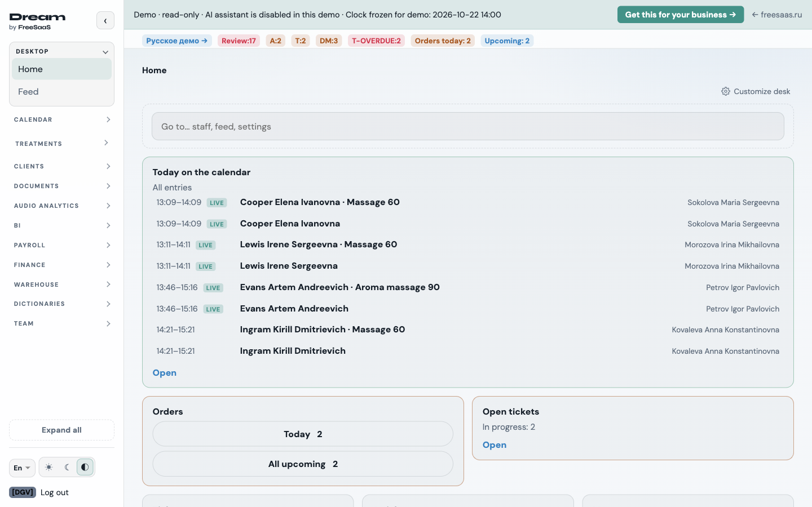
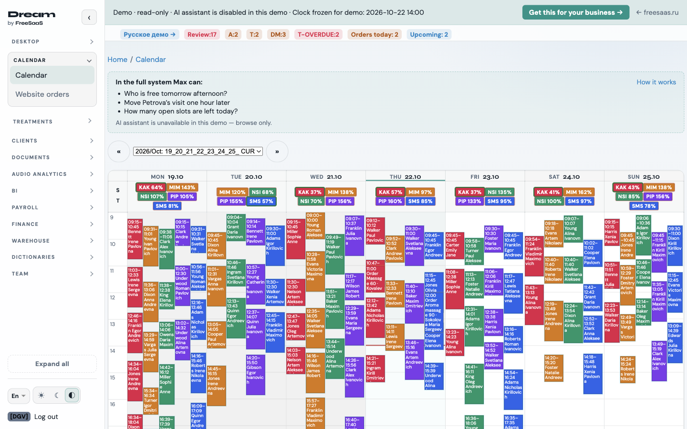
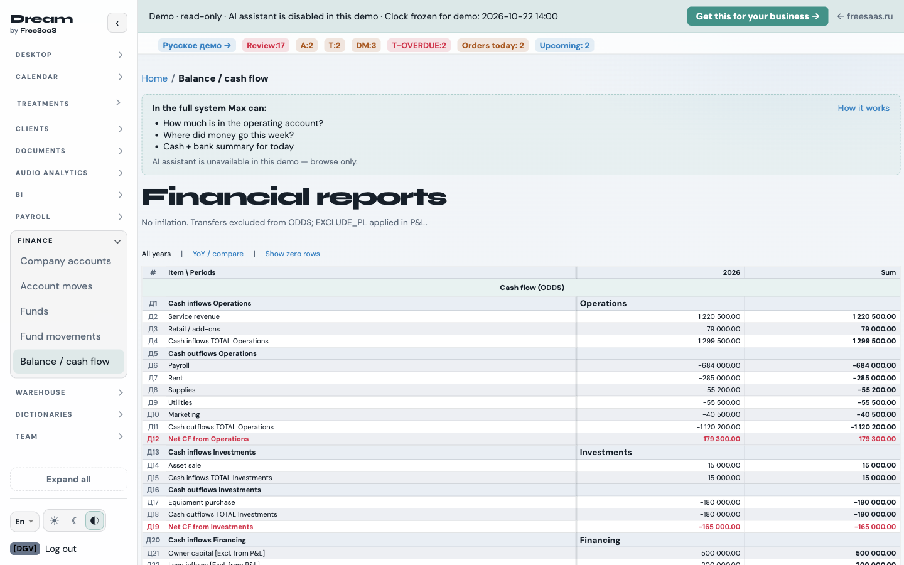

# FreeSaaS

**Open-source, self-hosted business operating system that AI agents install, configure and operate.**

Clients, booking, finance, warehouse, documents, audio and video analytics in one place. Your server, your data, no subscription plans. In real business since 2014, with 86,000+ clients in one database.

- **Website:** [freesaas.ru](https://freesaas.ru) ([English](https://en.freesaas.ru/))
- **Live demo:** [demoen.freesaas.ru](https://demoen.freesaas.ru) (English) · [demoru.freesaas.ru](https://demoru.freesaas.ru) (Russian) — opens already signed in, read-only, demo data is reset regularly
- **Contacts:** [msms2003@mail.ru](mailto:msms2003@mail.ru) · Telegram [@starcomm](https://t.me/starcomm) · bugs and feature requests — [GitHub Issues](https://github.com/FreeSaaSProject/freesaas/issues/new/choose)



| Calendar week | Financial reports |
|---|---|
|  |  |

## Why it is different

- **Agents are first-class operators.** Install, enable modules, migrate, diagnose, repair and update through a JSON CLI or HTTPS — no browser automation, works on shared hosting without SSH.
- **A core plus 70+ modules.** Start with one or two, enable the rest when the business needs them. Dependencies are declared in `module.json` and resolved for you.
- **700+ product operations** are exposed to agents as JSON and MCP tools — the same routes staff use in the UI, with the same permissions.
- **Open and repairable.** Plain PHP + MySQL, no framework, no build step. When something breaks, an agent can read the code, fix it locally and send the patch upstream.

## What is inside

Unmarked modules are `release`; **β** = beta, **α** = alpha (enabling needs an explicit risk acknowledgement).

| Area | Modules |
|------|---------|
| Clients | `clients`, `crm` α, `bonuses`, `certificates`, `contracts` |
| Booking | `booking`, `orders`, `resources` α, `client_mcp` α |
| Schedule | `calendar`, `workweeks` |
| Team and payroll | `vacations`, `rates`, `procents`, `staff_reports` |
| Finance | `ledger`, `finance`, `funds`, `payments`, `recons`, `remittances` β, `acquiring` α |
| Banks | `banks` β (Tochka, Alfa, T-Bank, Sber statements → cash moves) |
| Warehouse | `stocks`, `stickers`, `catalog`, `norms`, `units`, `suppliers` |
| Procedures | `procedures`, `cabinets`, `tables`, `laundry`, `terminals`, `likespa` |
| Documents | `docs` β (consents, medical cards, QR archive), `medcard_audio` α, `egisz` α |
| Audio analytics | `audio`, `audio_dicts`, `audio_pipeline`, `audio_reports`, `asr`, `audio_llm` β, `audio_diarize` β, `audio_script_coach` α, `audio_phrases` α |
| Video analytics | `video` α, `video_label` α |
| Polls and feedback | `polls` β, `poll_invites` β, `poll_speech` α |
| Reports | `bi` (JSON-recipe report constructor, share links) |
| Sites | `sites` (storefront + CMS, multi-domain, themes), `client_portal` α, `courses` α |
| Bots and AI | `bots` (Telegram, Max), `assistant`, `assistant_groups`, `llm` |
| Integrations | `amocrm` α, `bitrix` α, `yclients` β, `clientics` β, `gcal` β |
| Personal | `wellness`, `liquid_assets` |
| Platform | `core`, `updates`, `backups` α, `comments`, `demo` |

Live catalog with maturity and dependencies: [freesaas.ru/modules](https://freesaas.ru/modules/) · machine-readable: [`modules-catalog.json`](modules-catalog.json).

## Three agent surfaces

| Surface | Who | Auth | Use it for |
|---------|-----|------|-----------|
| **Platform ops** — `php bin/freesaas.php …` or HTTPS `/agent/*` | Installer / maintainer agent | `X-FreeSaaS-Agent-Token` | Bootstrap, enable modules, migrate, doctor, update, repair |
| **Staff tools** — session JSON or MCP `/llm/mcp` | Agent acting as an employee | Session or OAuth 2.1 | CRM, calendar, finance, warehouse operations with that employee's permissions |
| **Client tools** — MCP `/mcp` on each storefront domain | A customer's own AI agent | None (public, off by default) | Business info, free slots, booking, own bookings |

Details: [docs/agents/agent-surfaces.md](docs/agents/agent-surfaces.md) · [connect-mcp.md](docs/agents/connect-mcp.md) · [client-mcp.md](docs/agents/client-mcp.md).

Human architecture guide: [docs/GUIDE.md](docs/GUIDE.md) ([RU](docs/GUIDE.ru.md)).
Agent rules: [AGENTS.md](AGENTS.md). Quick path: [docs/agents/QUICKSTART.md](docs/agents/QUICKSTART.md).

## Agent TL;DR (≈2 minutes after DB + config)

```bash
cp cfg/config.example.ini cfg/config.ini   # set DB + salts
php bin/freesaas.php bootstrap --login=admin --password='…' --agent-token='…' --format=json
php bin/freesaas.php health --format=json
php bin/smoke.php --format=json
```

Shared hosting (no SSH): pre-set `app.agent_token` (or `var/setup.key`), then `POST /agent/bootstrap` — [docs/agents/install.md](docs/agents/install.md).  
Ops twin: CLI or `/agent/*` with `X-FreeSaaS-Agent-Token` (no anonymous virgin HTTP).  
Product tools (CRM ops): session JSON or MCP `/llm/mcp` + OAuth — [docs/agents/agent-surfaces.md](docs/agents/agent-surfaces.md).

## Agent Skills

Portable skills ([agentskills.io](https://agentskills.io/specification)) for discovery, deploy, and module enable — canonical tree: [`.agents/skills/`](.agents/skills/).

```bash
npx skills add FreeSaaSProject/freesaas
# or one skill:
npx skills add FreeSaaSProject/freesaas --skill freesaas-discovery
```

| Skill | When |
|-------|------|
| [`freesaas-discovery`](.agents/skills/freesaas-discovery/) | Fit assessment for business automation (even without naming FreeSaaS) |
| [`freesaas-deploy`](.agents/skills/freesaas-deploy/) | Bootstrap, doctor/smoke, shared-host `/agent/*` |
| [`freesaas-module-config`](.agents/skills/freesaas-module-config/) | Enable module sets + risk ack |

Compatible with Cursor, Claude Code, Codex, OpenCode and other skills-aware clients. Catalog: [skills.sh](https://skills.sh/) (listing appears after installs via the skills CLI). Distribution notes: [docs/agents/DISTRIBUTION_REPORT.md](docs/agents/DISTRIBUTION_REPORT.md).

## Docs

| Doc | Audience |
|-----|----------|
| [docs/GUIDE.md](docs/GUIDE.md) | Humans — architecture, modules ([RU](docs/GUIDE.ru.md)) |
| [AGENTS.md](AGENTS.md) | Coding agents — hard rules |
| [docs/agents/QUICKSTART.md](docs/agents/QUICKSTART.md) | Fast install + verify |
| [docs/agents/](docs/agents/) | Runbooks (install, MCP, create module, debug, cases) |
| [docs/agents/showcase/](docs/agents/showcase/) | What staff already ask the built-in assistant in chat |
| [docs/agent-native-audit.md](docs/agent-native-audit.md) | Agent-readiness standard |
| [docs/TABLE_MAP.md](docs/TABLE_MAP.md) | `base_*` table ownership |

## Quick start (detail)

1. Copy `cfg/config.example.ini` → `cfg/config.ini` (DB credentials, salts).
2. Module secrets: copy `modules/<id>/config.example.ini` → `cfg/modules/<id>.ini` when needed (gitignored).
3. Point vhost docroot at this folder (or use [Docker Compose](docker-compose.yml)).
4. Bootstrap or migrate:

```bash
# Greenfield
php bin/freesaas.php bootstrap --login=admin --password='…' --agent-token='…' --format=json

# Existing DB
php bin/freesaas.php migrate run
# optional: php bin/data-migrate.php
php bin/smoke.php --format=json
```

5. Sign in at `/login`. Diagnose anytime: `php bin/freesaas.php doctor --format=json`.

Requirements: PHP 7.4+ / 8.x, MySQL, Apache with `.htaccess` (or the bundled Docker Compose).

## Contacts

| Topic | Channel |
|-------|---------|
| General questions, partnership | [msms2003@mail.ru](mailto:msms2003@mail.ru) |
| Implementation | [msms2003@mail.ru](mailto:msms2003@mail.ru) or Telegram [@starcomm](https://t.me/starcomm) |
| Bugs and feature requests | [GitHub Issues](https://github.com/FreeSaaSProject/freesaas/issues/new/choose) |
| Questions / agent install cases | [GitHub Discussions](https://github.com/FreeSaaSProject/freesaas/discussions) |
| Security vulnerabilities | [SECURITY.md](SECURITY.md) — private report or email; not public Issues |
| Sponsor / support | [Boosty](https://boosty.to/freesaas) · Sponsor button on the repo · commercial license — [COMMERCIAL-LICENSE.md](COMMERCIAL-LICENSE.md) |

More: [freesaas.ru/contacts](https://freesaas.ru/contacts/).

## Licensing

FreeSaaS is dual-licensed (see also [NOTICE](NOTICE)):

- **Open source:** [GNU Affero General Public License v3 or later](LICENSE) (`AGPL-3.0-or-later`).
- **Commercial:** optional license from the copyright holder for use, modification, integration, or distribution without AGPL obligations — see [COMMERCIAL-LICENSE.md](COMMERCIAL-LICENSE.md).

Copyright © 2026 Ilya Kleshnin. “FreeSaaS” is the project name, not a separate legal entity.

External contributions require accepting the [CLA](CLA.md) — see [CONTRIBUTING.md](CONTRIBUTING.md). Third-party components and their licenses: [THIRD_PARTY.md](THIRD_PARTY.md).

Launch / distribution notes for maintainers: [docs/LAUNCH.md](docs/LAUNCH.md). Agent upstream path: [docs/agents/upstream.md](docs/agents/upstream.md).
