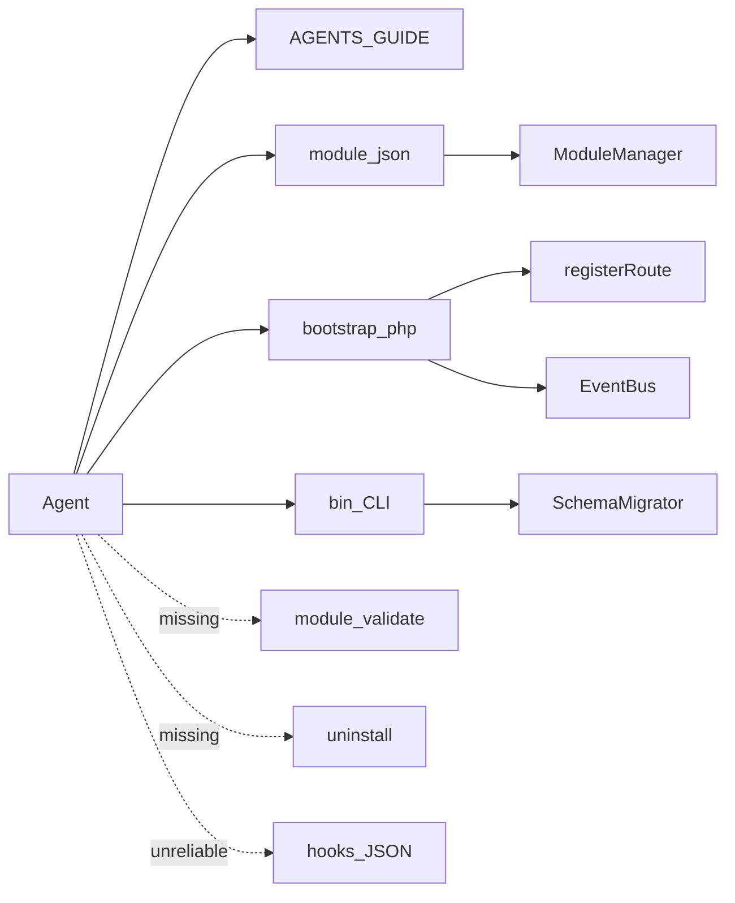
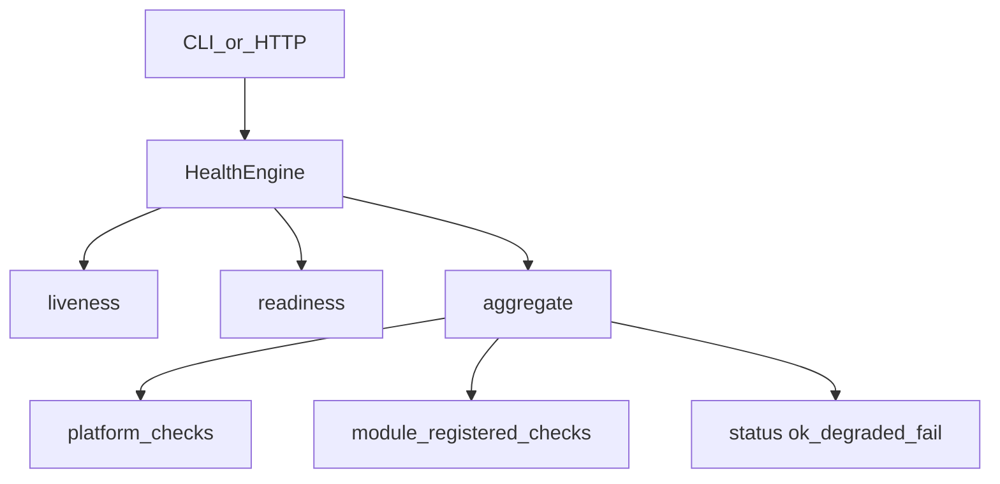

# FreeSaaS — Agent-Native Architecture Audit

**Date:** 2026-10-05  
**Scope:** Current modular refactor of `oper.likespa.hm` → FreeSaaS (repository as of audit).  
**Audience:** Product owners and coding agents. This document is both a diagnosis and a **working standard** for subsequent platform and module work.

Related docs:

- [`AGENTS.md`](../AGENTS.md) — hard rules for agents
- [`docs/GUIDE.md`](GUIDE.md) — human architecture guide
- [`docs/TABLE_MAP.md`](TABLE_MAP.md) — `base_*` table ownership by module

---

## Executive Summary

FreeSaaS already has a real **agent-friendly kernel**: filesystem module discovery, `module.json` + `bootstrap.php`, hard dependency graph, enable-time schema migrations, EventBus extension points, shared list/bulk/nav primitives, and operational docs (`AGENTS.md` + GUIDE). An unfamiliar agent can clone a simple CRUD module from `units` / `suppliers` and often succeed.

It is **not** yet agent-native for safe autonomous operations. Manifests are an incomplete and often inaccurate index; hooks are frequently prose or phantom; there is no uninstall; CLI cover only migrate-all and a **broken** i18n checker; there is no validate/health harness; soft cross-module coupling lives in PHP outside manifests; adding a new language still requires editing `I18n::$supported`; Telegram notifications exist only as stub user fields, not as a module.

**Agent Readiness: 56/100**

| Dimension | Score | Note |
|-----------|------:|------|
| Discoverability (docs + manifests) | 60 | Inventory yes; capabilities unreliable |
| New CRUD module authoring | 70 | Template + checklist work; conventions still guessed |
| Cross-module extension | 55 | EventBus strong; direct requires remain |
| Machine-readable contracts | 40 | Many JSON fields unused or wrong |
| CLI / admin ops without UI | 25 | Thin; no enable/health/validate |
| Self-verification | 15 | No tests/; check-i18n fatal |
| Localization automation | 55 | Chrome strong; locale allowlist + plurals weak |
| Lifecycle (install/uninstall) | 35 | Enable+migrate yes; uninstall no |
| Platform purity (vs LikeSpa) | 50 | Core still oper-shaped |

**Architecture verdict:** The current design **does not block** the agent-native concept. Do **not** rewrite Core. Evolve: honest contracts (generate/validate), CLI-first ops, health/validate, locale discovery, keep product out of Core.

**Control answers:**

1. Can an unfamiliar agent turn FreeSaaS into an IS for an arbitrary business **today**? Partially — select and wire existing modules with research; invent new domains with guessing; cannot safely uninstall or auto-prove «nothing broke».
2. Can an unfamiliar agent create a full new module from the repo alone? **Partially yes** for CRUD; **no** for full agent-operable lifecycle (validate/health/uninstall/tests).
3. Can an agent add a new language without changing business logic? **Almost** for catalogs; **no** without touching `I18n::$supported`; formatting/plurals incomplete.

---

## What Already Works

Do not redesign these — extend them.

1. **Module filesystem contract** — `modules/<id>/module.json` discovered by [`app/ModuleManager.php`](../app/ModuleManager.php) `discover()`; enabled modules boot `bootstrap.php`.
2. **Hard dependencies** — `requires` with semver; unmet deps block boot; disable refused if dependents enabled; `core` always on.
3. **Enable-time schema migrate** — `ModuleManager::setEnabled(true)` runs [`SchemaMigrator::runModule`](../app/SchemaMigrator.php) before writing config.
4. **EventBus spine** — hubs such as `core.dashboard.*`, `core.user_edit.*`, `core.layout.gate`, `core.bulk.check_item`, `core.settings.*`, `comments.*`, product settings events.
5. **Shared primitives** — `ListQuery`, `BulkActions`, `NavContext`, `Assets`, `View`, `Auth` (`can` / `canSeeInMenu` / `capability`).
6. **Operational agent docs** — [`AGENTS.md`](../AGENTS.md) checklist; GUIDE «Как добавить новый модуль».
7. **i18n chrome culture** — `t` / `te` / `tj`; every module ships `lang/ru.php` + `lang/en.php`; ~2473 keys with ru/en parity when catalogs are scanned directly.
8. **CRUD authoring template** — [`modules/units/`](../modules/units/) (mirror: `suppliers`): manifest, bootstrap routes, repository, list/edit pages, migration, BulkActions.
9. **Hard rules** — runtime `base_*` only; no second router/DI; product config in `cfg/modules/*.ini`.
10. **Additive migrations ledger** — `base_schema_migrations`; CLI `php bin/schema-migrate.php` / `php bin/data-migrate.php`.



---

## Critical Gaps

Problems that are expensive if ignored while the refactor continues. Prefer small evolutionary fixes.

### 1. Manifest is not a trustworthy contract

- **Problem:** Fields `hooks`, `provides`, `routes.pages`, `configSchema`, `jobs`, `migrations` (string) are largely documentation-only or inaccurate. Runtime truth is `bootstrap.php`.
- **Where:** e.g. [`modules/stocks/module.json`](../modules/stocks/module.json) — empty `hooks` while bootstrap listens to `core.user_edit.*`; [`modules/calendar/module.json`](../modules/calendar/module.json) — English prose in `publish`; [`modules/audio/module.json`](../modules/audio/module.json) — phantom `audio.records.for_day` / `audio.badge.state`; catalog `routes.pages` missing paths present in bootstrap.
- **Broken scenario:** Agent Test A — agent trusts `hooks`/`provides` to wire warehouse ↔ notifications; wires to non-events.
- **Minimal fix:** Stop prose in hooks; validate JSON against runtime (`bin/module-inspect` / `module-validate`); prefer generate-or-verify over a second hand-written schema. See [Requirements: Platform A1](#requirements-platform) and [Modules B1](#requirements-modules).
- **Cost later:** Agents and humans learn false APIs; drift compounds across 28+ modules.

### 2. No uninstall / rollback lifecycle

- **Problem:** Only enable/disable. Disable leaves tables, registry rows, and data. No down migrations.
- **Where:** [`app/ModuleManager.php`](../app/ModuleManager.php), [`app/SchemaMigrator.php`](../app/SchemaMigrator.php); UI `/modules`.
- **Broken scenario:** Agent creates experimental `equipment` module, then «remove without damaging the rest» — cannot.
- **Minimal fix:** Document **disable-only** policy now; reserve `uninstall.strategy` in manifest; implement drop later (P2).
- **Cost later:** OSS installs accumulate irreversible schema; agents fear creating modules.

### 3. No self-check harness

- **Problem:** No `tests/`, no CI, no `module validate`. [`bin/check-i18n.php`](../bin/check-i18n.php) fatals (incomplete bootstrap vs full app — missing `Assets` and peers) and only spot-checks four modules’ `module.json` labels.
- **Broken scenario:** After Agent Test B/C — agent cannot answer «I broke nothing?»
- **Minimal fix:** Fix check-i18n bootstrap; add `module-validate` + exit codes; smoke script (P1). See [A4](#a4-validate--self-check).
- **Cost later:** Every agent change needs human browser smoke; regressions undetectable.

### 4. Thin CLI — admin ops are UI/ini-bound

- **Problem:** Only all-module schema migrate and destructive data migrate. Enable/disable, pending migration list, health — UI or hand-edited ini.
- **Where:** [`bin/`](../bin/), GUIDE CLI table; modules UI [`modules/core/pages/modules.php`](../modules/core/pages/modules.php).
- **Broken scenario:** Headless agent must edit `cfg/config.ini` or click `/modules`.
- **Minimal fix:** CLI-first surface ([A2](#a2-lifecycle--admin-operations)); HTTP health optional duplicate of same logic.
- **Cost later:** MCP/skills built on UI scraping or fragile ini edits.

### 5. Soft / cross-module coupling hidden outside manifests

- **Problem:** `optionalRequires` is UI/docs; runtime uses `isEnabled`, `class_exists`, `tableExists`, and direct `require` of another module’s pages/libs (e.g. calendar → workweeks nazop; catalog product_edit loading foreign repos by path).
- **Broken scenario:** Disable optional module → silent fatal or blank feature; agent cannot see risk from JSON alone.
- **Minimal fix:** Ban new page-level cross-requires; require `optionalRequires` + `isEnabled` guards; validate soft-dep honesty over time.
- **Cost later:** Undebuggable partial installs.

### 6. Locale allowlist hardcoded in Core

- **Problem:** [`app/I18n.php`](../app/I18n.php) `$supported = ['ru','en']`. New locale needs a code change even if catalog files exist.
- **Broken scenario:** «Make this install fully Spanish» — agent must patch Core, not only add `lang/es.php` files.
- **Minimal fix:** Discover locales from catalogs/config ([A5](#a5-platform-localization)).
- **Cost later:** Every language becomes a Core PR.

### 7. Core still LikeSpa / oper-shaped

- **Problem:** Tickets `TYPE=2`, medical/admin status flags, menu group homes pointing at catalog/payments/ledger, default `dbase=likespa`, Telegram/Max field stubs and feature gates in user edit, hardcoded RU change-log fragments in ticket flow.
- **Where:** `modules/core`, [`app/Database.php`](../app/Database.php) default, [`modules/core/views/user_edit.php`](../modules/core/views/user_edit.php) (e.g. literal `Telegram chat_id`).
- **Broken scenario:** Generic OSS reader assumes spa/medical CRM is «the platform».
- **Minimal fix:** No new product rules in Core; extract/gate residuals; bot/Telegram → product module ([A7](#a7-core-hygiene)).
- **Cost later:** Platform purity almost impossible to recover.

---

## Important Improvements

Useful after the current refactor tranche; not blockers for continuing product porting.

| Improvement | Why |
|-------------|-----|
| Clean top manifests (stocks, calendar, audio*, ledger, finance, workweeks) | Immediate trust for discovery |
| `bulkActions` field in manifest (not hooks prose) | Machine index of list ops |
| Topological boot by `requires` (today: `ksort(id)`) | Soft `require_once` races |
| Shared menu homes resilient when product modules off | Broken rail landings |
| Notification / integration module skeleton (`notify.send`) | Agent Test C without inventing Telegram inside stocks |
| `I18n::choice` + locale number/currency helpers | Full locale quality |
| Structured app log (beyond `error_log` + StageTiming) | Diagnose without HTML footer |
| Per-module migrate CLI already mirrored in UI | Parity for agents |
| Description one-liner per module (`description` i18n key) | Scenario A without reading PHP |
| Extract ticket TYPE=2 / contract-lock UX toward contracts/tickets module | Core purity |

---

## Future Agent Layer

Leave out of Core internals. Build **after** CLI + validate + health exist.

| Layer | Role |
|-------|------|
| **MCP adapter** | Thin wrapper over CLI JSON; not a second source of truth inside PHP |
| **Skills (4–5)** | `create-module`, `add-migration-field`, `connect-via-event`, `add-locale`, `diagnose-install` |
| **Capability registry / marketplace** | Publish/discover modules beyond one repo |
| **Agent installer** | Greenfield deploy from requirements utterance |
| **OpenAPI for whole CRM** | Optional; page-first UI remains valid for humans |

Do not embed MCP server, marketplace, or mandatory PHPUnit-for-all into the current refactor.

---

## Localization Readiness

**Chrome readiness: ~62/100**  
**Full-installation localization: ~40/100**

### What works

- Dual catalogs for all 28 modules + `app/lang`
- Key parity ru/en (~2473 / ~2473 when scanned from files)
- Fallback: non-`ru` loads `ru` then overlays primary locale
- JS dict via `I18n::jsDict()` / `core.layout.gate` → `js_i18n`
- Module names, menu, permissions intended as i18n keys
- Missing key returns the key string (no crash)

### Gaps

| Gap | Impact |
|-----|--------|
| `$supported` hardcoded | New locale needs Core edit |
| `bin/check-i18n.php` broken + partial module.json scan | Agent cannot auto-prove completeness |
| No plural / ICU choice API | «N days» awkward |
| Numbers via ad-hoc `number_format(..., '.', ' ')` | RU-biased |
| Dates: thin `I18n::formatDate` if/else | No Intl month names centrally |
| Residual hardcoded labels | e.g. `Telegram chat_id`, `Max user_id` in user_edit view |
| Operational RU strings | payments/ledger/comments descriptions |
| No email / Telegram / installer locale layer | Product messaging outside chrome |
| UGC / DB `NAME` intentionally untranslated | Correct — document only |

### Target for agents

Agent adds `app/lang/es.php` + `modules/*/lang/es.php`, runs `locale validate`, enables locale via config/discovery — **without** changing repositories or business rules. Plurals/number formatting are P2 quality, not P0 blockers.

---

## Module Authoring Test

**Request:** equipment registry — name, serial, purchase date, unit, responsible staff, transfer history.

### What an unfamiliar agent finds without tribal knowledge

| Step | Clear from repo? | Source |
|------|------------------|--------|
| Where to create | Yes | `modules/<id>/`, AGENTS.md, GUIDE |
| Required files | Mostly | Checklist; template `units` |
| Register routes | Yes | `ModuleManager::registerRoute` samples |
| Declare deps | Yes | `requires` / `optionalRequires` |
| Migrations | Yes | `migrations/NNN_*.php` + SchemaMigrator |
| Backend / UI | Yes | clone units list/edit/repo |
| Permissions | Yes | `module.json` + route `permission` |
| Localization | Yes | `lang/ru.php` + `en.php` + `t()` |
| Events | Partial | GUIDE EventBus table; manifests often wrong |
| Tests | **No** | No harness |
| Install/enable | Partial | UI `/modules` or ini; no CLI |
| Uninstall | **No** | Missing |
| Verify result | **No** | Browser smoke only |

### Guessing required today (defects)

1. Menu: join `core.menu.group.*` vs `registerMenuGroup` for a new rail section  
2. When EventBus vs direct foreign `require_once`  
3. Permission vs `capability` / `registerFieldGroup`  
4. Transfer history: invent own tables; no entity schema language  
5. Link to staff: which user columns/APIs are stable  
6. How to prove enable succeeded beyond opening UI  
7. Boot order alphabetical — not dependency order  

**Verdict:** A new agent can ship a **usable CRUD+history module** by cloning `units` and reading AGENTS.md/GUIDE, but cannot meet the future [module acceptance bar](#b7-module-acceptance) without platform validate/health/CLI work.

---

## Agent Tests (scenarios)

### Scenario A — Discovery

> Need staff, vacations, warehouse, financial reporting, Telegram notifications.

| Need | Discoverable? | Notes |
|------|---------------|-------|
| Staff | Yes | `core` users |
| Vacations | Yes | `vacations` |
| Warehouse | Partial | `stocks` + `stickers` + `catalog`; soft deps; capabilities not in JSON |
| Finance reports | Yes | `finance` requires `ledger`; optional `funds` |
| Liquid assets / T-Invest | Yes | `liquid_assets` requires `ledger`; optional `funds`; disableable |
| Telegram notifications | **No** | Stub fields only; no sender module, no events |

Agent must still open PHP to learn real hooks, BulkActions, and role flags.

### Scenario B — Unknown feature

See [Module Authoring Test](#module-authoring-test).

### Scenario C — Modify stocks + Telegram alert

1. Find module — easy (`stocks`).  
2. Data model — read repository + migrations (tables list in JSON incomplete vs reality over time).  
3. Public vs internal — no formal boundary; repos are de facto API.  
4. Add min-qty field — feasible additive migration.  
5. Migrate existing installs — `SchemaMigrator` OK.  
6. Emit event — possible; not documented in stocks hooks today.  
7. Connect Telegram — **no target module**; agent invents coupling.  
8. UI + i18n — straightforward if following `t()`.  
9. Test — manual only.

---

## LikeSpa residue classification

| Residue | Class |
|---------|-------|
| Session `freesaas`, legacy password hash, `base_*` rule, EventBus, ModuleManager | Generic OK |
| News/tickets TYPE=2, curator/ОЛ flows, RU ticket diffs | Extract toward tickets/contracts over time |
| Status flags ZGV/STA/MARKET/ASSIST/PARTNER | Owning product modules via `registerFieldGroup` |
| Menu homes → `/catalog`, `/payments`, `/ledger/moves` | Product modules; resilient fallbacks |
| Messenger chat ids / bot gates in core user edit | Product `bots` module (`base_bot_links`, not columns on `base_users`) |
| `dbase=likespa`, repo path branding | Deployment only |
| sheets linen, massage tables, audio ASR workers | Already product modules — OK |

---

## Recommendations

### P0 — during current refactor

Architectural decisions expensive to reverse. Map to requirements A/B below.

| ID | Action | Req |
|----|--------|-----|
| P0.1 | Single source of truth for contracts: **validate/generate from runtime**; stop prose and phantoms in `hooks` | A1, B1 |
| P0.2 | Document lifecycle: **disable-only**; reserve `uninstall.strategy` | A2, B3 |
| P0.3 | No new LikeSpa/Telegram product rules in `app/` or core chrome | A7 |
| P0.4 | Locale list from discovery/config, not hardcoded PHP array | A5 |
| P0.5 | Ban **new** direct `require` of another module’s `pages/`; EventBus + `isEnabled` | B2, B6 |

### P1 — before first OSS release

| ID | Action | Req |
|----|--------|-----|
| P1.1 | Fix `bin/check-i18n.php`; exit codes; all modules’ manifest labels | A4, A5 |
| P1.2 | CLI: system status, module list/inspect/enable/disable, migrate status/run `--module`, locale validate, module validate, health | A2–A4, C |
| P1.3 | Platform health aggregation + module check registration API | A3, B4 |
| P1.4 | Clean priority manifests; optional `bulkActions` field | B1 |
| P1.5 | Minimal smoke script (lint + validate + i18n) | A4, B7 |
| P1.6 | Runbooks `docs/agents/` (create/modify/migrate/locale/debug) | A8 |
| P1.7 | i18n leftover labels (Telegram/Max fields) | B5 |

### P2 — after OSS release

| ID | Action | Req |
|----|--------|-----|
| P2.1 | Real uninstall for `drop_owned` | A2, B3 |
| P2.2 | Notifications module + EventBus integration pattern | B6 |
| P2.3 | Topological boot order | B2 |
| P2.4 | Plurals / number / currency helpers | A5 |
| P2.5 | Inspect exports: capabilities, BulkActions | A1 |
| P2.6 | Structured logging | A6 |
| P2.7 | Broader automated tests | A4 |

### P3 — prospective

| ID | Action |
|----|--------|
| P3.1 | MCP adapter over CLI |
| P3.2 | Skills set (≤5) |
| P3.3 | Public capability registry / marketplace |
| P3.4 | Agent installer |
| P3.5 | Optional OpenAPI islands where integrations need them |

---

## Requirements: Platform

Platform = `app/*` + `modules/core` chrome + `bin/*`.  
Levels: **must** (P0–P1), **should** (P2), **may** (P3).

Canonical agent protocol: **stable CLI + machine-readable JSON** (`--format=json`). MCP/skills are adapters. HTTP health must call the **same** check engine as CLI.

### A1. Discovery and capability catalog

**must**

- List modules: `id`, `version`, `enabled`, `blocked_reason`, `requires`, `optionalRequires`.
- Inspect module: routes (path, methods, permission, capability, public), permissions, menu, tables, real EventBus publish/subscribe names, config keys, jobs — from **runtime or validated manifest**, never free-text prose.
- Document core EventBus events and expected payload keys (informal schema OK at first).

**should**

- Export BulkActions and status capability groups from inspect.
- Either consume `provides` for soft discovery or stop treating it as required truth.

### A2. Lifecycle and admin operations

**must** CLI surface (names illustrative):

| Operation | Purpose |
|-----------|---------|
| `system status` | PHP/DB/config presence, locale, enabled count |
| `module list` / `inspect` / `enable` / `disable` | Lifecycle without UI |
| `migrate status` / `run [--module=id]` | Schema visibility and apply |
| `locale list` / `validate [--locale=xx]` | Localization completeness |
| `module validate [--module=id]` | Structural acceptance |
| `health` / `health --module=id` | Runtime checks |

**must** policy text: uninstall = **disable-only**; tables remain.  
**should** (P2): implement `uninstall` honoring `uninstall.strategy`.

### A3. Health / readiness / liveness

**must**

- **liveness** — process responds (cheap ping).
- **readiness** — config loaded, PDO up, core boot OK.
- **health** — aggregate over enabled modules: `ok | degraded | fail` + check list.

Check object shape:

```json
{
  "id": "stocks.tables",
  "module": "stocks",
  "status": "ok",
  "message": "base_stocks present",
  "duration_ms": 3,
  "meta": {}
}
```

Platform checks **must** include: DB connect; schema migrations table reachable; critical ini; blocked modules reported with reason.

**should:** `GET /health` (minimal, public) and/or `GET /health/detail` (authz) sharing CLI logic.

### A4. Validate / self-check

**must**

- Required files present; lang parity for supported locales; permission/menu labels are i18n keys; hooks are dotted event names only; `routes.pages` consistent with `registerRoute`; requires graph acyclic; config.example ↔ configSchema when both exist.
- Exit codes: `0` ok, `1` fail, `2` usage.
- Working i18n checker integrated into validate pipeline.

**should:** heuristic `tables` ⊆ migrations CREATE.  
**may:** full PHPUnit suite per module.

### A5. Platform localization

**must:** supported locales from filesystem/config discovery; documented fallback (currently `ru`); agent can add locale files + validate without business-logic edits.  
**should:** plurals, locale-aware number/currency.

### A6. Observability

**must:** CLI text + JSON.  
**should:** structured application log.  
StageTiming remains human UI; not the agent protocol.

### A7. Core hygiene

**must:** new product rules (bots, Telegram send, spa-only status semantics) live in product modules.  
**should:** menu group homes do not 404 when target modules are disabled.

### A8. Operations documentation

**must:** this audit + later `docs/agents/*` runbooks describe **operations** («to create a module, do X»), not project history. CLI is the canonical protocol reference.

---

## Requirements: Modules

Applies to **new** modules immediately; existing modules converge by priority (platform → finance/warehouse → audio family → rest).

### B1. Honest `module.json`

**must**

- `id`, `name` (i18n key), `version`, `type`, `requires`, `optionalRequires`, `permissions`, `menu` (if UI), `tables` (owned `base_*`), migrations path or explicit none.
- `hooks.publish` / `hooks.subscribe` — **only** real dotted EventBus names.
- `routes.pages` kept in sync with `registerRoute` (validate enforces).

**should**

- `configSchema` when `config.example.ini` exists.
- `jobs` when worker endpoints exist.
- `uninstall.strategy`: `leave_tables` | `drop_owned`.
- `bulkActions`: `{ list_id, action }[]` — not inside hooks.
- `description`: one i18n key or short English purpose string (pick one convention and stick to it).

**must not:** phantom events; prose hooks; unused permissions with no route/use.

**provides:** do not expand until platform consumes it.

### B2. Anatomy and registration

**must**

- `bootstrap.php`, `lang/{locale}.php` for every supported locale.
- Routes only via `ModuleManager::registerRoute`.
- Cross-module UI via EventBus; no new `require` of foreign `pages/`.
- Soft deps declared in `optionalRequires` and guarded with `ModuleManager::isEnabled` (plus `class_exists` / `tableExists` as needed).

### B3. Data and migrations

**must:** `base_*` only; additive idempotent-friendly migrations; owned tables listed; enable uses platform migrator; never drop foreign tables on uninstall.

### B4. Module health checks

Modules register checks through the platform API (target API; implement P1):

| Example check | Typical status if missing |
|---------------|---------------------------|
| Required tables/columns | `fail` |
| Required config keys | `fail` or `degraded` |
| Optional soft-dep absent | `skipped` or `degraded`, never hard `fail` |
| Worker token / external endpoint | only if runtime-required |
| Data invariants | `may` |

Statuses: `ok | degraded | fail | skipped`.  
Simple CRUD **should** rely on platform defaults («boot OK / migrations applied») if no custom checks.

### B5. Permissions, capabilities, UI

**must:** manifest permissions match route gates; capabilities via `StatusesRepository::registerFieldGroup`; UI via `t`/`te`/`tj`; menu group via shared key or own `registerMenuGroup`.

### B6. Events and integrations

**must:** honest publish/subscribe names.  
**should:** integrations (Telegram, email) via events or a notifications module — never stocks→telegram hardwire.

### B7. Module acceptance

A module is agent-operable when:

1. `module validate --module=<id>` → exit 0  
2. `locale validate` for all supported locales → exit 0  
3. After enable+migrate, `health --module=<id>` ≠ `fail`  
4. Smoke of primary list/edit routes (manual or script) — P1 for units-class modules  

### B8. Module documentation

One short purpose statement for agents (manifest `description` **or** GUIDE table — single source). No LikeSpa history essays inside product modules.

---

## Health model



| Level | Meaning | Example |
|-------|---------|---------|
| liveness | Process up | Front controller returns |
| readiness | Safe to serve traffic | Config + DB + core boot |
| health | Functional quality | Tables, tokens, soft-deps |

Aggregation rule (recommended): any `fail` → overall `fail`; else any `degraded` → `degraded`; else `ok`. `skipped` ignored for rollup.

---

## Agent operations protocol (CLI-first)

### Principles

1. Every substantial admin action available to machines **and** humans (UI may wrap CLI/services).  
2. Do not require browser automation for enable/migrate/validate/health.  
3. JSON output for agents; human text by default.  
4. MCP is an adapter, not the architecture.

### Target agent playbooks

**Discover capabilities**

```bash
php bin/module.php list --format=json
php bin/module.php inspect stocks --format=json
```

**Install / enable**

```bash
php bin/module.php enable equipment
php bin/migrate.php run --module=equipment
php bin/health.php --module=equipment --format=json
```

**Change + verify**

```bash
php bin/module.php validate --module=stocks
php bin/check-i18n.php   # or locale validate
php bin/health.php --format=json
```

**Add locale**

```bash
# add app/lang/es.php + modules/*/lang/es.php
php bin/locale.php validate --locale=es
# enable via config discovery — no business-logic edit
```

Exact binary layout may be one `bin/freesaas.php` with subcommands; the audit requires the **operations**, not a specific CLI framework.

### Out of scope for Core now

- In-process MCP server  
- Full CRM OpenAPI  
- Module marketplace  
- Mandatory PHPUnit for all 28 modules on day one  

These stay in [Future Agent Layer](#future-agent-layer); contracts + health + validate prepare the ground.

---

## Appendix: Current CLI vs target

| Capability | Status (post P1 sprint) |
|------------|-------------------------|
| `php bin/freesaas.php system status` | **Done** |
| `module list \| inspect \| enable \| disable \| validate` | **Done** |
| `migrate status \| run [--module]` | **Done** |
| `locale list \| validate` + discovery from `app/lang` | **Done** |
| `health [--module]` + `Health::register` | **Done** (auto tables + platform + audio_pipeline/calendar/ledger) |
| `GET /health` + `/health/detail` | **Done** |
| HTTP `/agent/*` + `app.agent_token` (CLI twin for shared hosting) | **Done** |
| Autonomous bootstrap (`POST /agent/bootstrap` + CLI `bootstrap`) | **Done** — [`docs/agents/install.md`](agents/install.md) |
| `bin/smoke.php` | **Done** |
| `bin/check-i18n.php` | **Fixed** (full bootstrap; exit codes) |
| Manifest hooks prose cleanup | **Done** (bulkActions field; dotted events only) |
| `docs/agents/*` runbooks | **Done** (incl. install) |
| Real uninstall / drop tables | Not yet (disable-only) |
| `php bin/data-migrate.php` | Unchanged (destructive; document) |

---

## Appendix: Score rationale (was 56 → ~75 after P1 + HTTP + bootstrap)

Weighted judgment, not a formula. After CLI/health/validate/locale discovery/HTTP health/hooks cleanup/runbooks/**autonomous bootstrap**, readiness nearer **~75**. Remaining drag: no uninstall, LikeSpa residue in Core, soft-dep honesty, plurals, incomplete OpenAPI/MCP (intentionally future).
