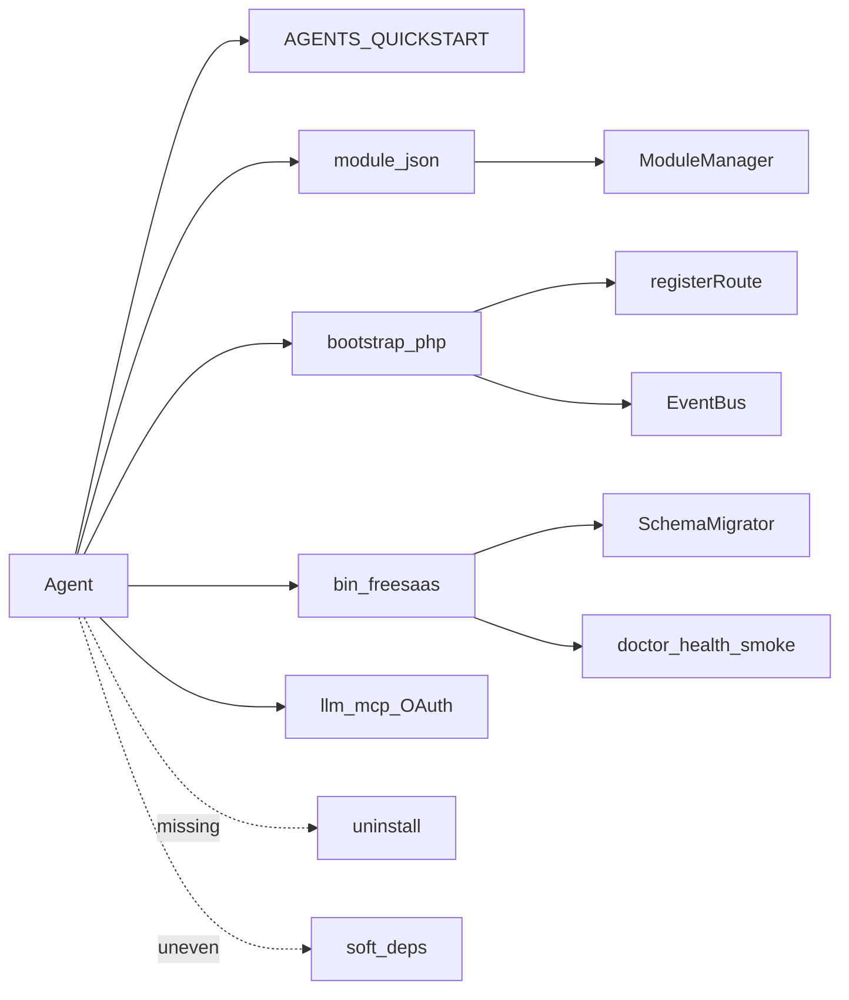
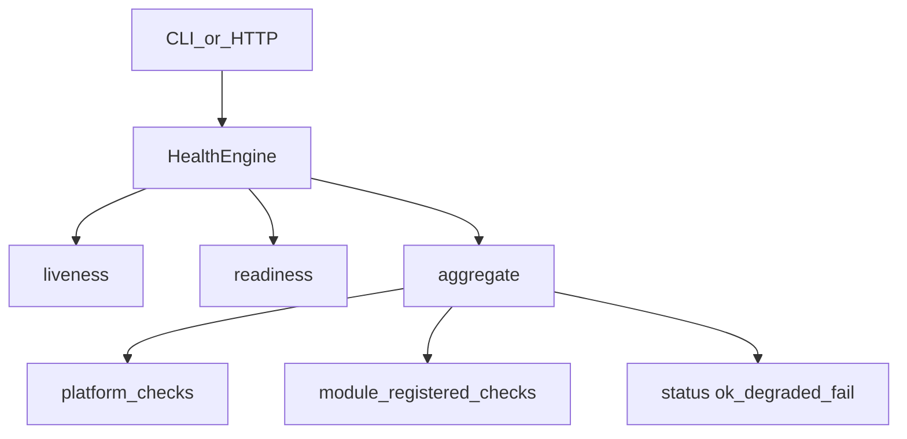

# FreeSaaS — Agent-Native Architecture Audit

**Date:** 2026-10-11 (full recount; original diagnosis 2026-10-05)  
**Scope:** Public platform [`ilcommm/freesaas`](https://github.com/ilcommm/freesaas) (AGPL dual-license). Instance branding theme lives in private [`ilcommm/freesaas-theme-likespa`](https://github.com/ilcommm/freesaas-theme-likespa).  
**Audience:** Product owners and coding agents. Working standard for platform/module work + readiness scoreboard.

Related docs:

- [`AGENTS.md`](../AGENTS.md) — hard rules for agents
- [`docs/GUIDE.md`](GUIDE.md) — human architecture guide
- [`docs/TABLE_MAP.md`](TABLE_MAP.md) — `base_*` table ownership by module
- [`docs/agents/QUICKSTART.md`](agents/QUICKSTART.md) — fast install
- [`docs/agents/agent-surfaces.md`](agents/agent-surfaces.md) — platform token vs product MCP/OAuth
- [`docs/LAUNCH.md`](LAUNCH.md) — distribution narrative

---

## Executive Summary

> **Current readiness (~87/100).** Platform **v0.3.34** after Wave A: soft-dep honesty in `module validate`, richer `module inspect` (agent_ops/hooks/bulk/capabilities/soft_deps), optional tokens as health `skipped` + `error_code`, doctor `warning_codes` (no false 503 for missing `agent_token`). Public OSS baseline was v0.3.33.
>
> **Remaining drag:** no uninstall/`drop_owned`, residual foreign page/view requires (warned), plurals/number formatting, Core still partly oper-shaped, dual auth surfaces (intentional), no marketplace / PHPUnit, real-world health `degraded` when cron/bank config incomplete (not optional tokens).

**Historical baseline (2026-10-05, pre-P1):** score **56/100** — thin CLI, no validate/health, broken i18n checker, unreliable manifests. Kept only as archaeology; do not treat body “Critical Gaps” prose from that era as today’s blockers without checking the [Resolved vs open](#resolved-vs-still-open) table.

**Agent Readiness:** **56** → **~75** (P1) → **~78** (MCP + packaging) → **~84** (public release) → **~87** (Wave A: soft-deps + inspect + doctor noise).

| Dimension | Baseline | Now | Note |
|-----------|---------:|----:|------|
| Discoverability (docs + manifests) | 60 | 88 | QUICKSTART, connect-*, cases, skills; public README pitch |
| New CRUD module authoring | 70 | 85 | `module create` + units template + authoring-contract |
| Cross-module extension | 55 | 72 | validate soft-dep honesty; legacy foreign requires warned |
| Machine-readable contracts | 40 | 84 | inspect exports ops/hooks/bulk/caps/soft_deps |
| CLI / admin ops without UI | 25 | 90 | `freesaas.php` + `/agent/*` + doctor |
| Self-verification | 15 | 90 | doctor warning_codes; optional tokens skipped not degraded |
| Localization automation | 55 | 78 | discovery + validate; plurals still weak |
| Lifecycle (install/uninstall) | 35 | 58 | bootstrap/enable/install yes; uninstall no |
| Platform purity (vs LikeSpa) | 50 | 70 | theme private; likespa module public & disableable |
| Licensing / OSS packaging | — | 95 | AGPL + commercial + CLA; public repo `freesaas` |

**Architecture verdict:** Do **not** rewrite Core. Evolve: honest contracts, CLI-first ops, keep product out of Core. Product MCP adapts `agent.ops`; platform lifecycle stays `agent_token`/CLI until an explicit admin threat model.

**Control answers (2026-10-11):**

1. Can an unfamiliar agent turn FreeSaaS into an IS for an arbitrary business **today**? **Yes** for composing existing modules (CLI/HTTP + cases); new domains via scaffold; cannot safely uninstall experiments.
2. Can an unfamiliar agent create a full new module from the repo alone? **Yes** for CRUD (`module create` → enable → validate → health); acceptance bar is met for units-class modules without uninstall.
3. Can an agent add a new language without changing business logic? **Yes** for catalogs via discovery + `locale validate`; plurals/number/currency formatting remain quality gaps.

---

## What Already Works

Do not redesign these — extend them.

1. **Module filesystem contract** — `modules/<id>/module.json` discovered by [`app/ModuleManager.php`](../app/ModuleManager.php) `discover()`; enabled modules boot `bootstrap.php` (~48 modules).
2. **Hard dependencies** — `requires` with semver; unmet deps block boot; disable refused if dependents enabled; `core` always on.
3. **Enable-time schema migrate** — `ModuleManager::setEnabled(true)` runs [`SchemaMigrator::runModule`](../app/SchemaMigrator.php) before writing config.
4. **EventBus spine** — hubs such as `core.dashboard.*`, `core.user_edit.*`, `core.layout.gate`, `core.bulk.check_item`, `core.settings.*`, `comments.*`, product settings events.
5. **Shared primitives** — `ListQuery`, `BulkActions`, `NavContext`, `Assets`, `View`, `Auth` (`can` / `canSeeInMenu` / `capability`).
6. **Operational agent surface** — CLI `bin/freesaas.php`, HTTP `/agent/*`, `doctor`, smoke; runbooks under [`docs/agents/`](agents/).
7. **i18n chrome culture** — `t` / `te` / `tj`; every module ships `lang/ru.php` + `lang/en.php`; ~5518 keys with ru/en parity (`locale validate` ok).
8. **CRUD authoring** — `module create` scaffold + [`modules/units/`](../modules/units/) template; [`authoring-contract.md`](agents/authoring-contract.md).
9. **Hard rules** — runtime `base_*` only; no second router/DI; product config in `cfg/modules/*.ini`.
10. **Additive migrations ledger** — `base_schema_migrations`; CLI `migrate status|run`.
11. **Product MCP + OAuth** — `/llm/mcp`, `agent.ops` (~388), assistant confirm writes; read-only `core.doctor` / `core.health.detail` on session/MCP.
12. **Public packaging** — AGPL dual-license + CLA; Docker Compose; release zip excludes private themes; UpdateEngine → `ilcommm/freesaas`.



---

## Resolved vs still open

| Was critical (2026-10-05) | Status now |
|---------------------------|------------|
| Thin CLI / no enable/health/validate | **Resolved** — `freesaas.php` + `/agent/*` |
| Broken i18n checker / no smoke | **Resolved** — `locale validate`, `smoke`, `doctor` |
| Locale allowlist hardcoded only | **Resolved** — discovery from `app/lang` + config |
| No bootstrap for agents | **Resolved** — CLI + `POST /agent/bootstrap` |
| No product MCP | **Resolved** — `/llm/mcp` + OAuth |
| OSS packaging / LICENSE | **Resolved** — public `freesaas`, AGPL + CLA |
| Instance theme in public tree | **Resolved** — private theme repo; purged from history |
| Manifest hooks prose/phantoms | **Mostly resolved** — validate + dotted events; soft drift remains |
| Soft / cross-module coupling | **Mostly resolved** — validate honesty + declared optionalRequires; legacy foreign requires = warnings |
| No uninstall / drop_owned | **Open** — disable-only (documented) |
| Core LikeSpa / oper residue | **Partially open** — theme out; tickets/flags/menu homes still Core-shaped |
| Plurals / ICU / number format | **Open** — P2 quality |
| Platform lifecycle on OAuth | **Open by design** — dual surface; see agent-surfaces |
| Marketplace / full PHPUnit | **Out of scope** for now |

## Critical gaps (still expensive)

Problems that remain after the OSS tranche. Prefer small evolutionary fixes.

### 1. Soft / cross-module coupling

- **Status:** Wave A — `ModuleValidator::scanSoftDeps` warns on undeclared `isEnabled`, errors on undeclared foreign `pages/`/`views/` requires; manifests honesty-fixed; inspect exposes `soft_deps`.
- **Residual:** a few declared foreign page/view requires (calendar→workweeks nazop, audio_reports embeds) — prefer EventBus for new code.

### 2. No uninstall / rollback lifecycle

- **Problem:** Only enable/disable. Disable leaves tables and data. No down migrations.
- **Policy:** disable-only until `uninstall.strategy=drop_owned` (P2.1).
- **Cost later:** OSS installs accumulate irreversible schema; agents fear experimental modules.

### 3. Core still partly oper-shaped

- **Problem:** Ticket TYPE quirks, some status flags, menu group homes, residual product-shaped defaults.
- **Mitigation done:** instance theme private; likespa is a normal disableable product module.
- **Minimal fix:** No new product rules in Core; extract residuals over time ([A7](#a7-core-hygiene)).

### 4. Dual agent surfaces (not a bug — document forever)

- **Platform:** `agent_token` / CLI — bootstrap, enable, migrate, update, doctor twin.
- **Product:** session / OAuth MCP — CRM `agent.ops`.
- Unifying lifecycle into staff OAuth needs an explicit admin scope threat model (not shipped).

---

## Important Improvements

Useful after the current refactor tranche; not blockers for continuing product porting.

| Improvement | Why |
|-------------|-----|
| Clean top manifests (stocks, calendar, audio*, ledger, finance, workweeks) | Immediate trust for discovery |
| `bulkActions` field in manifest (not hooks prose) | Machine index of list ops |
| Topological boot by `requires` (today: `ksort(id)`) | Soft `require_once` races |
| Shared menu homes resilient when product modules off | Broken rail landings |
| Notification / integration module skeleton (`notify.send`) | Agent Test C without inventing Telegram inside stocks |
| `I18n::choice` + locale number/currency helpers | Full locale quality |
| Structured app log (beyond `error_log` + StageTiming) | Diagnose without HTML footer |
| Per-module migrate CLI already mirrored in UI | Parity for agents |
| Description one-liner per module (`description` i18n key) | Scenario A without reading PHP |
| Extract ticket TYPE=2 / contract-lock UX toward contracts/tickets module | Core purity |

---

## Future Agent Layer

Leave marketplace and mandatory PHPUnit-for-all out of Core internals.

| Layer | Role | Status |
|-------|------|--------|
| **Product MCP + OAuth** | In-process `/llm/mcp` over `agent.ops` | **Shipped** — [`agents/llm.md`](agents/llm.md) |
| **Platform ops MCP** | Lifecycle (enable/migrate) via OAuth | Not shipped — stays `agent_token` / CLI; see [`agents/agent-surfaces.md`](agents/agent-surfaces.md) |
| **Skills (4–5)** | create-module, diagnose-install, … | In-repo under [`docs/skills/`](skills/) |
| **Capability registry / marketplace** | Publish/discover modules beyond one repo | Prospective |
| **Agent installer / Docker** | Greenfield deploy | Docker Compose shipped; utterance installer prospective |
| **OpenAPI for whole CRM** | Optional islands | OpenAPI for MCP tools only |

Do not treat product MCP as a second source of truth — tools mirror `agent.ops` / page handlers.

---

## Localization Readiness

**Chrome readiness: ~80/100**  
**Full-installation localization: ~55/100**

### What works

- Dual catalogs for all modules + `app/lang` (~5518 / ~5518 ru/en; `locale validate` → ok)
- Locale list from discovery / `app.locales` config (not a hardcoded two-locale PHP array)
- Fallback: non-`ru` loads `ru` then overlays primary locale
- JS dict via `I18n::jsDict()` / `core.layout.gate` → `js_i18n`
- Module names, menu, permissions as i18n keys
- Missing key returns the key string (no crash)
- `doctor` fails the install if locale catalogs diverge

### Gaps

| Gap | Impact |
|-----|--------|
| No plural / ICU choice API | «N days» awkward |
| Numbers via ad-hoc `number_format(..., '.', ' ')` | RU-biased |
| Dates: thin `I18n::formatDate` if/else | No Intl month names centrally |
| Residual hardcoded labels | occasional product chrome |
| Operational RU strings | some payments/ledger/comments descriptions |
| No email / Telegram / installer locale layer | Product messaging outside chrome |
| UGC / DB `NAME` intentionally untranslated | Correct — document only |

### Target for agents

Agent adds `app/lang/es.php` + `modules/*/lang/es.php`, runs `locale validate`, enables locale via config/discovery — **without** changing repositories or business rules. Plurals/number formatting are P2 quality, not P0 blockers.

---

## Module Authoring Test

**Request:** equipment registry — name, serial, purchase date, unit, responsible staff, transfer history.

### What an unfamiliar agent finds without tribal knowledge

| Step | Clear from repo? | Source |
|------|------------------|--------|
| Where to create | Yes | `module create`, AGENTS.md, authoring-contract |
| Required files | Yes | Scaffold + checklist |
| Register routes | Yes | Generated bootstrap + samples |
| Declare deps | Yes | `requires` / `optionalRequires` |
| Migrations | Yes | `module add-migration` + SchemaMigrator |
| Backend / UI | Yes | scaffold / clone `units` |
| Permissions | Yes | `module.json` + route `permission` |
| Localization | Yes | scaffold ships `lang/ru.php` + `en.php` |
| Events | Stronger | EventBus + validate soft-dep honesty; legacy foreign requires warned |
| Verify | Yes | `module validate`, `health`, `doctor`, smoke |
| Install/enable | Yes | CLI / `/agent/*` / UI |
| Uninstall | **No** | disable-only |

### Remaining guesses

1. Menu: join `core.menu.group.*` vs `registerMenuGroup` for a new rail section  
2. When EventBus vs (forbidden) foreign `pages/` require  
3. Permission vs `capability` / `registerFieldGroup`  
4. Transfer history: invent own tables; no entity schema language  
5. Boot order still alphabetical — not dependency topological  

**Verdict:** A new agent can ship a **units-class CRUD module** and meet [module acceptance](#b7-module-acceptance) (validate/health/locale) without tribal knowledge. Complex history/domain modules still need EventBus research. Uninstall remains the gap.

---

## Agent Tests (scenarios)

### Scenario A — Discovery

> Need staff, vacations, warehouse, financial reporting, Telegram notifications.

| Need | Discoverable? | Notes |
|------|---------------|-------|
| Staff | Yes | `core` users |
| Vacations | Yes | `vacations` |
| Warehouse | Partial | `stocks` + `stickers` + `catalog`; soft deps; capabilities not in JSON |
| Finance reports | Yes | `finance` requires `ledger`; optional `funds` |
| Liquid assets / T-Invest | Yes | `liquid_assets` requires `ledger`; optional `funds`; disableable |
| Telegram / Max transport | Yes | `bots` module + `BotPlugins` / `bots.send` (not Core stubs) |

Agent should prefer `module inspect` + `agent.ops` + EventBus docs over reading every repository.

### Scenario B — Unknown feature

See [Module Authoring Test](#module-authoring-test).

### Scenario C — Modify stocks + Telegram alert

1. Find module — easy (`stocks` / inspect).  
2. Data model — repository + migrations (`module add-migration`).  
3. Public vs internal — repos are de facto API; prefer EventBus.  
4. Add min-qty field — additive migration OK.  
5. Migrate — `migrate run --module=stocks`.  
6. Emit event — possible; declare in `hooks.publish`.  
7. Connect Telegram — via `bots` / EventBus, not inventing Core coupling.  
8. UI + i18n — `t()` both locales.  
9. Verify — `module validate`, `health`, `doctor` (not browser-only).

---

## LikeSpa residue classification

| Residue | Class |
|---------|-------|
| Session `freesaas`, legacy password hash, `base_*` rule, EventBus, ModuleManager | Generic OK |
| News/tickets TYPE=2, curator/ОЛ flows, RU ticket diffs | Extract toward tickets/contracts over time |
| Status flags ZGV/STA/MARKET/ASSIST/PARTNER | Owning product modules via `registerFieldGroup` |
| Menu homes → `/catalog`, `/payments`, `/ledger/moves` | Product modules; resilient fallbacks |
| Messenger chat ids / bot gates in core user edit | Product `bots` module (`base_bot_links`, not columns on `base_users`) |
| `dbase=` default / host branding | Deployment only; public repo is `ilcommm/freesaas` |
| sheets linen, massage tables, audio ASR workers | Already product modules — OK |

---

## Recommendations

### P0 — architectural (mostly landed)

| ID | Action | Status |
|----|--------|--------|
| P0.1 | Validate contracts; stop prose/phantoms in `hooks` | **Mostly done** — keep enforcing |
| P0.2 | Document lifecycle: **disable-only**; reserve `uninstall.strategy` | **Done** (policy); implement drop = P2.1 |
| P0.3 | No new LikeSpa/Telegram product rules in `app/` or core chrome | **Ongoing** |
| P0.4 | Locale list from discovery/config | **Done** |
| P0.5 | Ban **new** direct `require` of another module’s `pages/` | **Ongoing** |

### P1 — before first OSS release — **DONE** (v0.3.33)

| ID | Action | Status |
|----|--------|--------|
| P1.1–P1.7 | i18n checker, CLI ops, health, manifests, smoke, runbooks, leftover labels | **Done** |

Also shipped beyond original P1: bootstrap HTTP twin, product MCP/OAuth, `doctor`, `module create`, Docker, public packaging.

### P2 — after OSS release (active backlog)

| ID | Action | Req |
|----|--------|-----|
| P2.1 | Real uninstall for `drop_owned` | A2, B3 |
| P2.2 | Notifications module + EventBus integration pattern | B6 |
| P2.3 | Topological boot order | B2 |
| P2.4 | Plurals / number / currency helpers | A5 |
| P2.5 | Inspect exports: capabilities, BulkActions | **Done** (Wave A) |
| P2.6 | Structured logging | A6 |
| P2.7 | Broader automated tests | A4 |

### P3 — prospective

| ID | Action | Note |
|----|--------|------|
| P3.1 | MCP adapter over CLI | **Superseded** by in-process product MCP; lifecycle stays token/CLI |
| P3.2 | Skills set (≤5) | **Done** — `docs/skills/` |
| P3.3 | Public capability registry / marketplace | Prospective |
| P3.4 | Agent installer | Docker Compose shipped; utterance installer later |
| P3.5 | Optional OpenAPI islands | `/llm/openapi.json` for tools |

---

## Requirements: Platform

Platform = `app/*` + `modules/core` chrome + `bin/*`.  
Levels: **must** (P0–P1), **should** (P2), **may** (P3).

Canonical agent protocol: **stable CLI + machine-readable JSON** (`--format=json`). MCP/skills are adapters. HTTP health must call the **same** check engine as CLI.

### A1. Discovery and capability catalog

**must**

- List modules: `id`, `version`, `enabled`, `blocked_reason`, `requires`, `optionalRequires`.
- Inspect module: routes (path, methods, permission, capability, public), permissions, menu, tables, real EventBus publish/subscribe names, config keys, jobs — from **runtime or validated manifest**, never free-text prose.
- Document core EventBus events and expected payload keys (informal schema OK at first).

**should**

- Export BulkActions and status capability groups from inspect.
- Either consume `provides` for soft discovery or stop treating it as required truth.

### A2. Lifecycle and admin operations

**must** CLI surface (names illustrative):

| Operation | Purpose |
|-----------|---------|
| `system status` | PHP/DB/config presence, locale, enabled count |
| `module list` / `inspect` / `enable` / `disable` | Lifecycle without UI |
| `migrate status` / `run [--module=id]` | Schema visibility and apply |
| `locale list` / `validate [--locale=xx]` | Localization completeness |
| `module validate [--module=id]` | Structural acceptance |
| `health` / `health --module=id` | Runtime checks |

**must** policy text: uninstall = **disable-only**; tables remain.  
**should** (P2): implement `uninstall` honoring `uninstall.strategy`.

### A3. Health / readiness / liveness

**must**

- **liveness** — process responds (cheap ping).
- **readiness** — config loaded, PDO up, core boot OK.
- **health** — aggregate over enabled modules: `ok | degraded | fail` + check list.

Check object shape:

```json
{
  "id": "stocks.tables",
  "module": "stocks",
  "status": "ok",
  "message": "base_stocks present",
  "duration_ms": 3,
  "meta": {}
}
```

Platform checks **must** include: DB connect; schema migrations table reachable; critical ini; blocked modules reported with reason.

**should:** `GET /health` (minimal, public) and/or `GET /health/detail` (authz) sharing CLI logic.

### A4. Validate / self-check

**must**

- Required files present; lang parity for supported locales; permission/menu labels are i18n keys; hooks are dotted event names only; `routes.pages` consistent with `registerRoute`; requires graph acyclic; config.example ↔ configSchema when both exist.
- Exit codes: `0` ok, `1` fail, `2` usage.
- Working i18n checker integrated into validate pipeline.

**should:** heuristic `tables` ⊆ migrations CREATE.  
**may:** full PHPUnit suite per module.

### A5. Platform localization

**must:** supported locales from filesystem/config discovery; documented fallback (currently `ru`); agent can add locale files + validate without business-logic edits.  
**should:** plurals, locale-aware number/currency.

### A6. Observability

**must:** CLI text + JSON.  
**should:** structured application log.  
StageTiming remains human UI; not the agent protocol.

### A7. Core hygiene

**must:** new product rules (bots, Telegram send, spa-only status semantics) live in product modules.  
**should:** menu group homes do not 404 when target modules are disabled.

### A8. Operations documentation

**must:** this audit + later `docs/agents/*` runbooks describe **operations** («to create a module, do X»), not project history. CLI is the canonical protocol reference.

---

## Requirements: Modules

Applies to **new** modules immediately; existing modules converge by priority (platform → finance/warehouse → audio family → rest).

### B1. Honest `module.json`

**must**

- `id`, `name` (i18n key), `version`, `type`, `requires`, `optionalRequires`, `permissions`, `menu` (if UI), `tables` (owned `base_*`), migrations path or explicit none.
- `hooks.publish` / `hooks.subscribe` — **only** real dotted EventBus names.
- `routes.pages` kept in sync with `registerRoute` (validate enforces).

**should**

- `configSchema` when `config.example.ini` exists.
- `jobs` when worker endpoints exist.
- `uninstall.strategy`: `leave_tables` | `drop_owned`.
- `bulkActions`: `{ list_id, action }[]` — not inside hooks.
- `description`: one i18n key or short English purpose string (pick one convention and stick to it).

**must not:** phantom events; prose hooks; unused permissions with no route/use.

**provides:** do not expand until platform consumes it.

### B2. Anatomy and registration

**must**

- `bootstrap.php`, `lang/{locale}.php` for every supported locale.
- Routes only via `ModuleManager::registerRoute`.
- Cross-module UI via EventBus; no new `require` of foreign `pages/`.
- Soft deps declared in `optionalRequires` and guarded with `ModuleManager::isEnabled` (plus `class_exists` / `tableExists` as needed).

### B3. Data and migrations

**must:** `base_*` only; additive idempotent-friendly migrations; owned tables listed; enable uses platform migrator; never drop foreign tables on uninstall.

### B4. Module health checks

Modules register checks through the platform API (target API; implement P1):

| Example check | Typical status if missing |
|---------------|---------------------------|
| Required tables/columns | `fail` |
| Required config keys | `fail` or `degraded` |
| Optional soft-dep absent | `skipped` or `degraded`, never hard `fail` |
| Worker token / external endpoint | only if runtime-required |
| Data invariants | `may` |

Statuses: `ok | degraded | fail | skipped`.  
Simple CRUD **should** rely on platform defaults («boot OK / migrations applied») if no custom checks.

### B5. Permissions, capabilities, UI

**must:** manifest permissions match route gates; capabilities via `StatusesRepository::registerFieldGroup`; UI via `t`/`te`/`tj`; menu group via shared key or own `registerMenuGroup`.

### B6. Events and integrations

**must:** honest publish/subscribe names.  
**should:** integrations (Telegram, email) via events or a notifications module — never stocks→telegram hardwire.

### B7. Module acceptance

A module is agent-operable when:

1. `module validate --module=<id>` → exit 0  
2. `locale validate` for all supported locales → exit 0  
3. After enable+migrate, `health --module=<id>` ≠ `fail`  
4. Smoke of primary list/edit routes (manual or script) — P1 for units-class modules  

### B8. Module documentation

One short purpose statement for agents (manifest `description` **or** GUIDE table — single source). No LikeSpa history essays inside product modules.

---

## Health model



| Level | Meaning | Example |
|-------|---------|---------|
| liveness | Process up | Front controller returns |
| readiness | Safe to serve traffic | Config + DB + core boot |
| health | Functional quality | Tables, tokens, soft-deps |

Aggregation rule (recommended): any `fail` → overall `fail`; else any `degraded` → `degraded`; else `ok`. `skipped` ignored for rollup.

---

## Agent operations protocol (CLI-first)

### Principles

1. Every substantial admin action available to machines **and** humans (UI may wrap CLI/services).  
2. Do not require browser automation for enable/migrate/validate/health.  
3. JSON output for agents; human text by default.  
4. MCP is an adapter, not the architecture.

### Target agent playbooks

**Discover capabilities**

```bash
php bin/freesaas.php module list --format=json
php bin/freesaas.php module inspect stocks --format=json
php bin/freesaas.php doctor --format=json
```

**Install / enable**

```bash
php bin/freesaas.php module create equipment --title='Equipment' --format=json
php bin/freesaas.php module enable equipment --accept-risk --format=json
php bin/freesaas.php migrate run --module=equipment --format=json
php bin/freesaas.php health --module=equipment --format=json
```

**Change + verify**

```bash
php bin/freesaas.php module validate stocks --format=json
php bin/freesaas.php locale validate --format=json
php bin/smoke.php --format=json
```

**Add locale**

```bash
# add app/lang/es.php + modules/*/lang/es.php
php bin/freesaas.php locale validate --locale=es --format=json
# enable via config discovery — no business-logic edit
```

Canonical binary: `bin/freesaas.php` (HTTP twin `/agent/*`).

### Out of scope for Core now

- Full CRM OpenAPI (tools OpenAPI island exists)  
- Module marketplace  
- Mandatory PHPUnit for all modules on day one  
- Unifying platform lifecycle into staff OAuth without a separate admin threat model  

Product MCP is **in scope and shipped**; see [Future Agent Layer](#future-agent-layer).

---

## Appendix: Current CLI vs target

| Capability | Status |
|------------|--------|
| `php bin/freesaas.php system status` | **Done** |
| `module list \| inspect \| enable \| disable \| validate \| create \| add-migration \| bump` | **Done** |
| `migrate status \| run [--module]` | **Done** |
| `locale list \| validate` + discovery from `app/lang` | **Done** |
| `health [--module]` + `Health::register` | **Done** |
| `doctor` (+ `/agent/doctor`) | **Done** |
| `GET /health` + `/health/detail` | **Done** |
| HTTP `/agent/*` + `app.agent_token` (CLI twin for shared hosting) | **Done** |
| Autonomous bootstrap (`POST /agent/bootstrap` + CLI `bootstrap`) | **Done** — [`docs/agents/install.md`](agents/install.md) |
| Product MCP `/llm/mcp` + OAuth | **Done** — [`docs/agents/llm.md`](agents/llm.md) |
| Dual-license AGPL + commercial + CLA | **Done** |
| `bin/smoke.php` | **Done** |
| `bin/check-i18n.php` | **Fixed** (full bootstrap; exit codes) |
| Manifest hooks prose cleanup | **Done** (bulkActions field; dotted events only) |
| `docs/agents/*` runbooks | **Done** (QUICKSTART, agent-surfaces, cases, repair, connect-*, skills) |
| Docker Compose greenfield | **Done** |
| Public repo `ilcommm/freesaas` + private theme repo | **Done** |
| MCP tools `core.doctor` / `core.health.detail` | **Done** |
| Real uninstall / drop tables | Not yet (disable-only) |
| `php bin/data-migrate.php` | Unchanged (destructive; document) |

---

## Appendix: Score rationale (56 → ~75 → ~78 → ~84 → **~87**)

Weighted judgment, not a formula.

| Era | Score | What moved the needle |
|-----|------:|------------------------|
| 2026-10-05 baseline | 56 | Kernel + docs; ops thin |
| Post-P1 | ~75 | CLI, health, validate, bootstrap, smoke, runbooks |
| MCP + packaging draft | ~78 | `/llm/mcp`, dual-license docs |
| Public release 2026-10-11 | ~84 | doctor, scaffold, Docker, QUICKSTART/connect/skills/cases, public `freesaas`, theme split/history purge, ~388 agent.ops, locale ~5518 |
| **Wave A (soft-deps + inspect)** | **~87** | validate soft-dep honesty, inspect exports, optional tokens skipped, doctor `warning_codes` |

**Still capping the score:** uninstall (`drop_owned`), Core purity leftovers, plurals, no marketplace/PHPUnit, intentional dual auth surfaces, health `degraded` when cron/real config incomplete.
