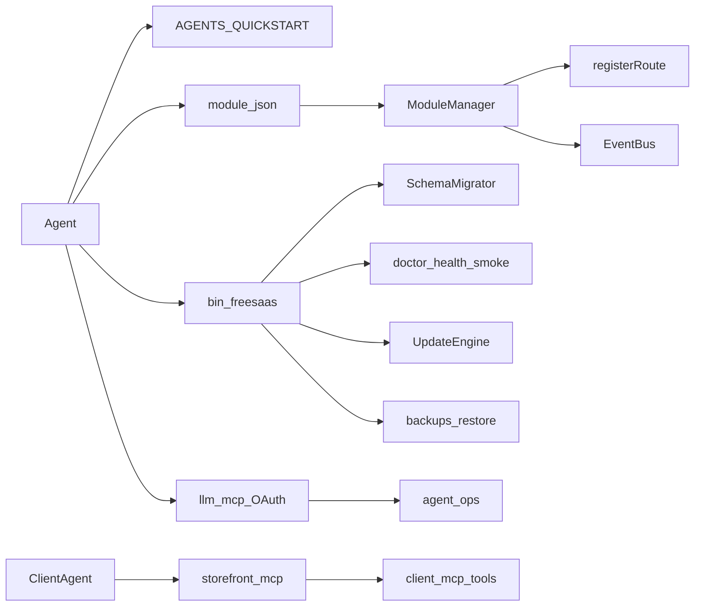
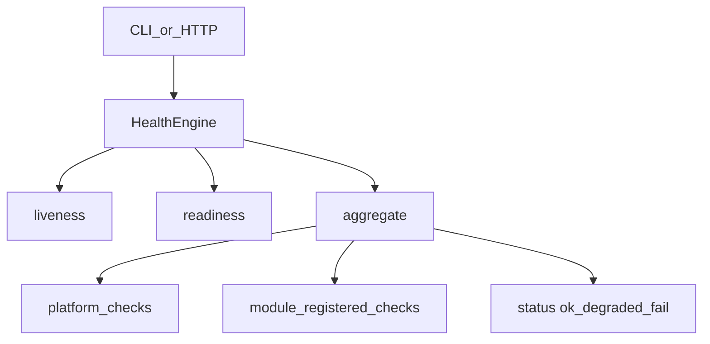

# FreeSaaS — Agent-Native Architecture Audit

**Snapshot:** 2026-11-21, platform **v1.1.8** (previous full recount 2026-10-11 at v0.3.34; original diagnosis 2026-10-05).  
**Scope:** Public platform [`FreeSaaSProject/freesaas`](https://github.com/FreeSaaSProject/freesaas) (AGPL dual-license). Instance branding themes live in private repos (see [`agents/themes.md`](agents/themes.md)).  
**Audience:** Product owners and coding agents.

This document has two parts with different lifetimes:

- **Scoreboard** (the sections up to [Requirements: Platform](#requirements-platform)) — a dated snapshot. Numbers go stale; re-count with the commands below before quoting them.
- **Standard** ([Requirements: Platform](#requirements-platform), [Requirements: Modules](#requirements-modules), [Health model](#health-model), [Agent operations protocol](#agent-operations-protocol-cli-first)) — normative, changes rarely.

Related docs:

- [`AGENTS.md`](../AGENTS.md) — hard rules for agents
- [`docs/GUIDE.md`](GUIDE.md) — human architecture guide
- [`docs/TABLE_MAP.md`](TABLE_MAP.md) — `base_*` table ownership by module
- [`docs/agents/QUICKSTART.md`](agents/QUICKSTART.md) — fast install
- [`docs/agents/agent-surfaces.md`](agents/agent-surfaces.md) — platform token vs product MCP/OAuth vs public client MCP
- [`docs/LAUNCH.md`](LAUNCH.md) — distribution narrative

---

## Snapshot (2026-11-21, v1.1.8)

| Fact | Value | How to re-count |
|------|------:|-----------------|
| Platform version | 1.1.8 | `cat VERSION` (derived from `modules/core/module.json`) |
| Modules in the tree | 72 | `php bin/freesaas.php module list --format=json` |
| Maturity | 46 release / 10 beta / 16 alpha | `module list --maturity=alpha\|beta\|release` |
| Product `agent.ops` | 739 across 70 modules (`comments`, `demo` have none) | sum of `agent.ops` in `modules/*/module.json` |
| Locale keys | 12 062 ru = 12 062 en | `php bin/freesaas.php locale validate --format=json` |
| `module validate` (all) | 0 errors, 22 warnings | `php bin/freesaas.php module validate --format=json` |
| Scheduled jobs | 43 `Cron::register` | `rg "Cron::register\(" modules/*/bootstrap.php` |
| Long jobs | 28 `LongJob::register` | `rg "LongJob::register\(" modules/*/bootstrap.php` |
| Module health checks | 29 `Health::register` | `rg "Health::register\(" modules/*/bootstrap.php` |
| Static guards | 26 `bin/check-*.php`, CI in `.github/workflows/ci.yml` | `ls bin/check-*.php` |

Of the 22 validate warnings on the audited instance, 11 are «module disabled — route registration not checked» (12 of 72 modules are off there); the rest are 5 route/manifest mismatches, 3 undeclared `isEnabled` soft deps and 3 declared foreign `pages/`/`views/` requires.

## Executive Summary

> **Current readiness (~89/100).** Since the October recount the platform went from v0.3.34 to v1.1.8 and from ~48 to 72 modules, and the agent surface grew with it: self-update with private module/theme sources, backups with restore and warm standby, a hard cron registry, long jobs, module maturity with risk acknowledgement, a public client MCP per storefront domain, an in-system assistant, and a CI gate that keeps every route covered by an `agent.ops` entry.
>
> **Remaining drag:** boot order is still alphabetical (not by `requires`), no plural / locale-aware number formatting, no structured application log, no PHPUnit, Core still partly instance-shaped, dual auth surfaces (intentional), no cross-repo marketplace.

**Agent Readiness:** **56** (2026-10-05) → **~87** (2026-10-11, Wave A) → **~89** (2026-11-21). History: [Appendix: Score history](#appendix-score-history).

| Dimension | 2026-10-05 | 2026-10-11 | Now | Why it moved (or did not) |
|-----------|-----------:|-----------:|----:|---------------------------|
| Discoverability (docs + manifests) | 60 | 88 | 90 | Every module ships `description` + `module.summary` keys and `catalog` (categories, maturity); `modules-catalog.json`; portable skills in `.agents/skills/`. The `AGENTS.md` module table had drifted (8 modules missing) — now guarded by `bin/check-docs-modules.php` |
| New CRUD module authoring | 70 | 85 | 86 | Unchanged contract: `module create` + `units` template + authoring-contract; acceptance now includes agent coverage |
| Cross-module extension | 55 | 72 | 75 | 0 validate errors on 72 modules; 3 undeclared soft deps and 3 declared foreign requires remain as warnings |
| Machine-readable contracts | 40 | 84 | 90 | 739 `agent.ops`; `bin/check-agent-coverage.php` in CI fails on a new uncovered route or a removed op |
| CLI / admin ops without UI | 25 | 90 | 92 | `update`, `backups`, `cron`, `user`, `demo`, `bot` commands; module-owned `/agent/<module>/*` repair routes (bots, gcal, llm, sites, audio) |
| Self-verification | 15 | 90 | 91 | 26 static guards + smoke + doctor in CI; still no unit tests |
| Localization automation | 55 | 78 | 78 | Keys doubled with ru/en parity kept; plurals and number/currency formatting still missing |
| Lifecycle (install → update → uninstall) | 35 | 82 | 88 | Self-update (core, private modules, themes) with conflict resolve; backups + restore wizard + standby; maturity risk ack; uninstall dump→DROP |
| Platform purity (vs instance branding) | 50 | 70 | 72 | Themes private; spa pack disableable; ticket TYPE quirks and menu homes still Core-shaped |
| Licensing / OSS packaging | — | 95 | 95 | AGPL + commercial + CLA; public repo, releases, demo stands |

Scores are a weighted judgment, not a formula.

**Architecture verdict:** Do **not** rewrite Core. Evolve: honest contracts, CLI-first ops, keep product out of Core. Product MCP adapts `agent.ops`; platform lifecycle stays `agent_token`/CLI until an explicit admin threat model.

**Control answers (2026-11-21):**

1. Can an unfamiliar agent turn FreeSaaS into an IS for an arbitrary business **today**? **Yes** for composing existing modules (CLI/HTTP + cases + module catalog with maturity); new domains via scaffold; experiments can be uninstalled with dump→DROP (`confirm_uninstall`; `leave_tables` modules stay disable-only).
2. Can an unfamiliar agent create a full new module from the repo alone? **Yes** for CRUD (`module create` → enable → validate → health → agent coverage); acceptance bar includes uninstall for `drop_owned`.
3. Can an agent add a new language without changing business logic? **Yes** for catalogs via discovery + `locale validate`; plurals/number/currency formatting remain quality gaps.
4. Can an agent keep an install alive without a human? **Mostly** — `doctor` → [`agents/repair.md`](agents/repair.md), `update apply`, backups and restore are all on the token surface; alpha/beta modules carry an explicit «diagnose and repair» policy.

---

## What Already Works

Do not redesign these — extend them.

1. **Module filesystem contract** — `modules/<id>/module.json` discovered by [`app/ModuleManager.php`](../app/ModuleManager.php) `discover()`; enabled modules boot `bootstrap.php` (72 modules).
2. **Hard dependencies** — `requires` with semver; unmet deps block boot; disable refused if dependents enabled; `core` always on.
3. **Enable-time schema migrate** — `ModuleManager::setEnabled(true)` runs [`SchemaMigrator::runModule`](../app/SchemaMigrator.php) before writing config.
4. **EventBus spine** — hubs such as `core.dashboard.*`, `core.user_edit.*`, `core.layout.gate`, `core.bulk.check_item`, `core.settings.*`, `comments.*`, `sites.*`, `client_mcp.tools`, product settings events.
5. **Shared primitives** — `ListQuery`, `BulkActions`, `NavContext`, `Assets`, `View`, `Auth` (`can` / `canSeeInMenu` / `capability`), `Cron`, `LongJob`, `SafeHttp`.
6. **Operational agent surface** — CLI `bin/freesaas.php`, HTTP `/agent/*`, `doctor`, smoke; runbooks under [`docs/agents/`](agents/).
7. **i18n chrome culture** — `t` / `te` / `tj`; every module ships `lang/ru.php` + `lang/en.php`; ru/en parity enforced by `locale validate` and `doctor`.
8. **CRUD authoring** — `module create` scaffold + [`modules/units/`](../modules/units/) template; [`authoring-contract.md`](agents/authoring-contract.md).
9. **Hard rules** — runtime `base_*` only; no second router/DI; product config in `cfg/modules/*.ini`.
10. **Additive migrations ledger** — `base_schema_migrations`; CLI `migrate status|run`.
11. **Product MCP + OAuth** — `/llm/mcp` over `agent.ops`; in-system assistant with confirm-before-write ([`agents/assistant.md`](agents/assistant.md)); read-only `core.doctor` / `core.health.detail` on session/MCP.
12. **Public client MCP** — `client_mcp`: anonymous `/mcp` per storefront domain, tool registry via EventBus `client_mcp.tools` ([`agents/client-mcp.md`](agents/client-mcp.md)).
13. **Module maturity** — `catalog.maturity` = `alpha|beta|release`; enabling alpha/beta needs `--accept-risk`; `maturity_policy` on `GET /agent/modules` tells agents to diagnose, repair locally and upstream.
14. **Self-update** — `UpdateEngine` reads `modules/<id>/module.json` versions; core, private modules and themes from `cfg/updates.ini`; conflicts listed and resolvable by agents ([`agents/update.md`](agents/update.md)).
15. **Background work** — one host crontab line → `/cron/tick` with a journal ([`agents/cron.md`](agents/cron.md)); heavy staff operations as `LongJob` start/tick/cancel ([`agents/long-jobs.md`](agents/long-jobs.md)).
16. **Backups** — scheduled DB + files to FTP/FTPS, hourly CDC increments, restore wizard, warm standby ([`agents/backups.md`](agents/backups.md)).
17. **Agent coverage gate** — `bin/check-agent-coverage.php`: every `routes.pages` path / POST action keeps an `agent.ops` entry; frozen gaps in [`agents/agent-coverage-baseline.json`](agents/agent-coverage-baseline.json).
18. **Public packaging** — AGPL dual-license + CLA; Docker Compose; release zip excludes private themes; read-only demo stands (`demo` module).



---

## Resolved vs still open

Re-checked against the code on 2026-11-21.

| Item | Status now | Evidence |
|------|------------|----------|
| Thin CLI / no enable/health/validate | **Resolved** | `bin/freesaas.php` + `/agent/*` |
| Broken i18n checker / no smoke | **Resolved** | `locale validate`, `smoke`, `doctor` |
| Locale allowlist hardcoded only | **Resolved** | discovery from `app/lang` + config |
| No bootstrap for agents | **Resolved** | CLI + `POST /agent/bootstrap` |
| No product MCP | **Resolved** | `/llm/mcp` + OAuth |
| OSS packaging / LICENSE | **Resolved** | public `freesaas`, AGPL + CLA |
| Instance theme in public tree | **Resolved** | private theme repos |
| No uninstall / drop_owned | **Resolved** | dump→DROP + agent/CLI/UI; `leave_tables` opt-out |
| Notifications module (was P2.2) | **Resolved** | `bots` module: `bots.send`, `BotPlugins`, queue `base_telegram_sends` (Telegram, Max). No email channel |
| Inspect exports capabilities / BulkActions (was P2.5) | **Resolved** | `module inspect` → `bulk_actions`, `soft_deps`, `capability_groups`, `agent_ops`, `hooks` |
| One-line module description (was «Important») | **Resolved** | `description` + `{id}.module.summary` keys in all 72 manifests |
| Manifest hooks prose/phantoms | **Mostly resolved** | validate enforces dotted events; 5 route/manifest mismatch warnings left |
| Soft / cross-module coupling | **Mostly resolved** | 0 errors; 3 undeclared `isEnabled`, 3 declared foreign requires (warnings) |
| Core instance residue | **Partially open** | ticket TYPE=2 flows, some flags and menu homes still in Core |
| Topological boot order (P2.3) | **Open** | `ModuleManager::discover()` still `ksort`s by id |
| Plurals / number / currency helpers (P2.4) | **Open** | no `I18n::choice`; ~146 ad-hoc `number_format` calls |
| Structured application log (P2.6) | **Open** | `error_log` + `StageTiming` only |
| Broader automated tests (P2.7) | **Open** | static guards + smoke; no PHPUnit |
| Menu group homes when the target module is off | **Open** | `core.menu.group.*` homes point at `/payments`, `/ledger/moves`, `/catalog` |
| Platform lifecycle on OAuth | **Open by design** | dual surface; see agent-surfaces |
| Cross-repo marketplace | **Out of scope** | `modules-catalog.json` + private sources cover one publisher |

## Critical gaps (still expensive)

Prefer small evolutionary fixes.

### 1. Soft / cross-module coupling

- **Status:** `ModuleValidator::scanSoftDeps` warns on undeclared `isEnabled`, errors on undeclared foreign `pages/`/`views/` requires; inspect exposes `soft_deps`.
- **Residual:** a few declared foreign page/view requires (calendar → workweeks, audio_reports embeds) and three undeclared `isEnabled` guards — prefer EventBus for new code.

### 2. Boot order

- **Problem:** modules boot alphabetically, so a soft `require_once` of another module's lib can race.
- **Minimal fix:** topological sort by `requires` in `ModuleManager::discover()`.

### 3. Uninstall / rollback lifecycle

- **Status:** `module uninstall --confirm` / `POST /agent/modules/{id}/uninstall` with `confirm_uninstall=1`: mandatory dump of `tables[]` → DROP → clear ledger → disable. Code on disk remains. `uninstall.strategy=leave_tables` refuses DROP.
- **Residual:** no down-migrations; shared columns/indexes on foreign tables are not reverted on uninstall. `tables[]` = exclusive ownership (validate rejects duplicates).

### 4. Core still partly instance-shaped

- **Problem:** Ticket TYPE quirks, some status flags, menu group homes, residual product-shaped defaults.
- **Minimal fix:** No new product rules in Core; extract residuals over time ([A7](#a7-core-hygiene)).

### 5. Three agent surfaces (not a bug — document forever)

- **Platform:** `agent_token` / CLI — bootstrap, enable, migrate, update, doctor twin.
- **Product:** session / OAuth MCP — `agent.ops` with staff permissions.
- **Client:** anonymous `/mcp` per storefront domain — customer tools only.
- Unifying lifecycle into staff OAuth needs an explicit admin scope threat model (not shipped).

---

## Backlog

| ID | Action | Status |
|----|--------|--------|
| P0.3 | No new instance/Telegram product rules in `app/` or core chrome | **Ongoing** |
| P0.5 | Ban **new** direct `require` of another module's `pages/` | **Ongoing** |
| P2.3 | Topological boot order | Open |
| P2.4 | Plurals / number / currency helpers (`I18n::choice`) | Open |
| P2.6 | Structured logging | Open |
| P2.7 | Broader automated tests | Open |
| — | Menu group homes resilient when product modules are off | Open |
| — | Extract ticket TYPE=2 / contract-lock UX toward contracts/tickets module | Open |
| — | Email channel next to `bots` | Open |
| P3.3 | Public capability registry / marketplace | Prospective |
| P3.4 | Utterance installer (Docker Compose already shipped) | Prospective |

## Future Agent Layer

| Layer | Role | Status |
|-------|------|--------|
| **Product MCP + OAuth** | In-process `/llm/mcp` over `agent.ops` | **Shipped** — [`agents/llm.md`](agents/llm.md) |
| **Client MCP** | Public per-domain `/mcp` for customers' agents | **Shipped (alpha)** — [`agents/client-mcp.md`](agents/client-mcp.md) |
| **In-system assistant** | UI + bot harness over the same tools, confirm writes | **Shipped** — [`agents/assistant.md`](agents/assistant.md) |
| **Portable skills** | discovery, deploy, module-config | **Shipped** — [`.agents/skills/`](../.agents/skills/) (short playbooks in [`docs/skills/`](skills/)) |
| **Platform ops MCP** | Lifecycle (enable/migrate) via OAuth | Not shipped — stays `agent_token` / CLI; see [`agents/agent-surfaces.md`](agents/agent-surfaces.md) |
| **Capability registry / marketplace** | Publish/discover modules beyond one publisher | Prospective |
| **OpenAPI for whole CRM** | Optional islands | `/llm/openapi.json` for MCP tools only |

Do not treat product MCP as a second source of truth — tools mirror `agent.ops` / page handlers.

---

## Localization Readiness

**Chrome readiness: ~80/100**  
**Full-installation localization: ~55/100**

### What works

- Dual catalogs for all modules + `app/lang` (12 062 / 12 062 ru/en; `locale validate` → ok)
- Locale list from discovery / `app.locales` config (not a hardcoded two-locale PHP array)
- Fallback: non-`ru` loads `ru` then overlays primary locale
- JS dict via `I18n::jsDict()` / `core.layout.gate` → `js_i18n`
- Module names, descriptions, menu, permissions as i18n keys
- Storefront host can force its own locale (`base_site_hosts.locale`)
- Missing key returns the key string (no crash)
- `doctor` fails the install if locale catalogs diverge

### Gaps

| Gap | Impact |
|-----|--------|
| No plural / ICU choice API | «N days» awkward |
| Numbers via ad-hoc `number_format(..., '.', ' ')` | RU-biased |
| Dates: thin `I18n::formatDate` if/else | No Intl month names centrally |
| Residual hardcoded labels | occasional product chrome |
| Operational RU strings | some payments/ledger/comments descriptions |
| No email / installer locale layer | Product messaging outside chrome |
| UGC / DB `NAME` intentionally untranslated | Correct — document only |

### Target for agents

Agent adds `app/lang/es.php` + `modules/*/lang/es.php`, runs `locale validate`, enables locale via config/discovery — **without** changing repositories or business rules. Plurals/number formatting are P2 quality, not P0 blockers.

---

## Module Authoring Test

**Request:** equipment registry — name, serial, purchase date, unit, responsible staff, transfer history.

| Step | Clear from repo? | Source |
|------|------------------|--------|
| Where to create | Yes | `module create`, AGENTS.md, authoring-contract |
| Required files | Yes | Scaffold + checklist |
| Register routes | Yes | Generated bootstrap + samples |
| Declare deps | Yes | `requires` / `optionalRequires` |
| Migrations | Yes | `module add-migration` + SchemaMigrator |
| Backend / UI | Yes | scaffold / clone `units` |
| Permissions | Yes | `module.json` + route `permission` |
| Localization | Yes | scaffold ships `lang/ru.php` + `en.php` |
| Agent JSON | Yes | `agent.ops` + [`module-agent-api.md`](agents/module-agent-api.md); coverage check tells what is missing |
| Events | Mostly | EventBus + validate soft-dep honesty |
| Verify | Yes | `module validate`, `health`, `doctor`, smoke |
| Install/enable | Yes | CLI / `/agent/*` / UI |
| Uninstall | Yes | dump owned tables → DROP; `leave_tables` refuses |

### Remaining guesses

1. Menu: join `core.menu.group.*` vs `registerMenuGroup` for a new rail section  
2. When EventBus vs (forbidden) foreign `pages/` require  
3. Permission vs `capability` / `registerFieldGroup`  
4. Transfer history: invent own tables; no entity schema language  
5. Boot order still alphabetical — not dependency topological  

**Verdict:** A new agent can ship a **units-class CRUD module** and meet [module acceptance](#b7-module-acceptance) without tribal knowledge. Complex history/domain modules still need EventBus research.

---

## Agent Tests (scenarios)

### Scenario A — Discovery

> Need staff, vacations, warehouse, financial reporting, Telegram notifications.

| Need | Discoverable? | Notes |
|------|---------------|-------|
| Staff | Yes | `core` users |
| Vacations | Yes | `vacations` |
| Warehouse | Yes | `stocks` + `stickers` + `catalog`; deps and summary in `module list` / catalog |
| Finance reports | Yes | `finance` requires `ledger`; optional `funds` |
| Telegram / Max transport | Yes | `bots` module + `BotPlugins` / `bots.send` |

Agent should prefer `module list --category=…`, `module inspect` and `agent.ops` over reading every repository.

### Scenario B — Unknown feature

See [Module Authoring Test](#module-authoring-test).

### Scenario C — Modify stocks + Telegram alert

1. Find module — easy (`stocks` / inspect).  
2. Data model — repository + migrations (`module add-migration`).  
3. Public vs internal — repos are de facto API; prefer EventBus.  
4. Add min-qty field — additive migration OK.  
5. Migrate — `migrate run --module=stocks`.  
6. Emit event — possible; declare in `hooks.publish`.  
7. Connect Telegram — via `bots` / EventBus, not inventing Core coupling.  
8. UI + i18n — `t()` both locales.  
9. Verify — `module validate`, `health`, `doctor` (not browser-only).

---

## Instance residue classification

| Residue | Class |
|---------|-------|
| Session `freesaas`, legacy password hash, `base_*` rule, EventBus, ModuleManager | Generic OK |
| News/tickets TYPE=2, curator/owner flows, RU ticket diffs | Extract toward tickets/contracts over time |
| Status flags ZGV/STA/MARKET/ASSIST/PARTNER | Owning product modules via `registerFieldGroup` |
| Menu homes → `/catalog`, `/payments`, `/ledger/moves` | Product modules; resilient fallbacks |
| Messenger chat ids / bot gates | Product `bots` module (`base_bot_links`, not columns on `base_users`) |
| laundry linen, massage tables, audio ASR workers, spa pack | Already product modules — OK |

---

## Requirements: Platform

Platform = `app/*` + `modules/core` chrome + `bin/*`.  
Levels: **must** (P0–P1), **should** (P2), **may** (P3).

Canonical agent protocol: **stable CLI + machine-readable JSON** (`--format=json`). MCP/skills are adapters. HTTP health must call the **same** check engine as CLI.

### A1. Discovery and capability catalog

**must**

- List modules: `id`, `version`, `enabled`, `blocked_reason`, `requires`, `optionalRequires`.
- Inspect module: routes (path, methods, permission, capability, public), permissions, menu, tables, real EventBus publish/subscribe names, config keys, jobs — from **runtime or validated manifest**, never free-text prose.
- Document core EventBus events and expected payload keys (informal schema OK at first).

**should**

- Export BulkActions and status capability groups from inspect.
- Either consume `provides` for soft discovery or stop treating it as required truth.

### A2. Lifecycle and admin operations

**must** CLI surface (names illustrative):

| Operation | Purpose |
|-----------|---------|
| `system status` | PHP/DB/config presence, locale, enabled count |
| `module list` / `inspect` / `enable` / `disable` / `uninstall --confirm` | Lifecycle without UI |
| `migrate status` / `run [--module=id]` | Schema visibility and apply |
| `locale list` / `validate [--locale=xx]` | Localization completeness |
| `module validate [--module=id]` | Structural acceptance |
| `health` / `health --module=id` | Runtime checks |

**must** policy: disable leaves tables; uninstall dumps owned tables then DROP (refused if `leave_tables`); never drop foreign tables.

### A3. Health / readiness / liveness

**must**

- **liveness** — process responds (cheap ping).
- **readiness** — config loaded, PDO up, core boot OK.
- **health** — aggregate over enabled modules: `ok | degraded | fail` + check list.

Check object shape:

```json
{
  "id": "stocks.tables",
  "module": "stocks",
  "status": "ok",
  "message": "base_stocks present",
  "duration_ms": 3,
  "meta": {}
}
```

Platform checks **must** include: DB connect; schema migrations table reachable; critical ini; blocked modules reported with reason.

**should:** `GET /health` (minimal, public) and/or `GET /health/detail` (authz) sharing CLI logic.

### A4. Validate / self-check

**must**

- Required files present; lang parity for supported locales; permission/menu labels are i18n keys; hooks are dotted event names only; `routes.pages` consistent with `registerRoute`; requires graph acyclic; config.example ↔ configSchema when both exist.
- Exit codes: `0` ok, `1` fail, `2` usage.
- Working i18n checker integrated into validate pipeline.

**should:** heuristic `tables` ⊆ migrations CREATE.  
**may:** full PHPUnit suite per module.

### A5. Platform localization

**must:** supported locales from filesystem/config discovery; documented fallback (currently `ru`); agent can add locale files + validate without business-logic edits.  
**should:** plurals, locale-aware number/currency.

### A6. Observability

**must:** CLI text + JSON.  
**should:** structured application log.  
StageTiming remains human UI; not the agent protocol.

### A7. Core hygiene

**must:** new product rules (bots, Telegram send, spa-only status semantics) live in product modules.  
**should:** menu group homes do not 404 when target modules are disabled.

### A8. Operations documentation

**must:** this audit + later `docs/agents/*` runbooks describe **operations** («to create a module, do X»), not project history. CLI is the canonical protocol reference.

---

## Requirements: Modules

Applies to **new** modules immediately; existing modules converge by priority (platform → finance/warehouse → audio family → rest).

### B1. Honest `module.json`

**must**

- `id`, `name` (i18n key), `version`, `type`, `requires`, `optionalRequires`, `permissions`, `menu` (if UI), `tables` (owned `base_*`), migrations path or explicit none.
- `hooks.publish` / `hooks.subscribe` — **only** real dotted EventBus names.
- `routes.pages` kept in sync with `registerRoute` (validate enforces).

**should**

- `configSchema` when `config.example.ini` exists.
- `jobs` when worker endpoints exist.
- `uninstall.strategy`: `leave_tables` | `drop_owned`.
- `bulkActions`: `{ list_id, action }[]` — not inside hooks.
- `description`: one i18n key or short English purpose string (pick one convention and stick to it).

**must not:** phantom events; prose hooks; unused permissions with no route/use.

**provides:** do not expand until platform consumes it.

### B2. Anatomy and registration

**must**

- `bootstrap.php`, `lang/{locale}.php` for every supported locale.
- Routes only via `ModuleManager::registerRoute`.
- Cross-module UI via EventBus; no new `require` of foreign `pages/`.
- Soft deps declared in `optionalRequires` and guarded with `ModuleManager::isEnabled` (plus `class_exists` / `tableExists` as needed).

### B3. Data and migrations

**must:** `base_*` only; additive idempotent-friendly migrations; owned tables listed; enable uses platform migrator; never drop foreign tables on uninstall.

### B4. Module health checks

Modules register checks through the platform API (`Health::register` in `bootstrap.php`):

| Example check | Typical status if missing |
|---------------|---------------------------|
| Required tables/columns | `fail` |
| Required config keys | `fail` or `degraded` |
| Optional soft-dep absent | `skipped` or `degraded`, never hard `fail` |
| Worker token / external endpoint | only if runtime-required |
| Data invariants | `may` |

Statuses: `ok | degraded | fail | skipped`.  
Simple CRUD **should** rely on platform defaults («boot OK / migrations applied») if no custom checks.

### B5. Permissions, capabilities, UI

**must:** manifest permissions match route gates; capabilities via `StatusesRepository::registerFieldGroup`; UI via `t`/`te`/`tj`; menu group via shared key or own `registerMenuGroup`.

### B6. Events and integrations

**must:** honest publish/subscribe names.  
**should:** integrations (Telegram, email) via events or a notifications module — never stocks→telegram hardwire.

### B7. Module acceptance

A module is agent-operable when:

1. `module validate --module=<id>` → exit 0  
2. `locale validate` for all supported locales → exit 0  
3. After enable+migrate, `health --module=<id>` ≠ `fail`  
4. Smoke of primary list/edit routes (manual or script) — P1 for units-class modules  

### B8. Module documentation

One short purpose statement for agents (manifest `description` **or** GUIDE table — single source). No instance-history essays inside product modules.

---

## Health model



| Level | Meaning | Example |
|-------|---------|---------|
| liveness | Process up | Front controller returns |
| readiness | Safe to serve traffic | Config + DB + core boot |
| health | Functional quality | Tables, tokens, soft-deps |

Aggregation rule (recommended): any `fail` → overall `fail`; else any `degraded` → `degraded`; else `ok`. `skipped` ignored for rollup.

---

## Agent operations protocol (CLI-first)

### Principles

1. Every substantial admin action available to machines **and** humans (UI may wrap CLI/services).  
2. Do not require browser automation for enable/migrate/validate/health.  
3. JSON output for agents; human text by default.  
4. MCP is an adapter, not the architecture.

### Target agent playbooks

**Discover capabilities**

```bash
php bin/freesaas.php module list --format=json
php bin/freesaas.php module inspect stocks --format=json
php bin/freesaas.php doctor --format=json
```

**Install / enable**

```bash
php bin/freesaas.php module create equipment --title='Equipment' --format=json
php bin/freesaas.php module enable equipment --accept-risk --format=json
php bin/freesaas.php migrate run --module=equipment --format=json
php bin/freesaas.php health --module=equipment --format=json
```

**Change + verify**

```bash
php bin/freesaas.php module validate stocks --format=json
php bin/freesaas.php locale validate --format=json
php bin/smoke.php --format=json
```

**Add locale**

```bash
# add app/lang/es.php + modules/*/lang/es.php
php bin/freesaas.php locale validate --locale=es --format=json
# enable via config discovery — no business-logic edit
```

Canonical binary: `bin/freesaas.php` (HTTP twin `/agent/*`).

### Out of scope for Core now

- Full CRM OpenAPI (tools OpenAPI island exists)  
- Module marketplace  
- Mandatory PHPUnit for all modules on day one  
- Unifying platform lifecycle into staff OAuth without a separate admin threat model  

Product MCP is **in scope and shipped**; see [Future Agent Layer](#future-agent-layer).

---

## Appendix: CLI surface

Canonical reference is `php bin/freesaas.php` (no arguments prints the full list). HTTP twin: `/agent/*` with `X-FreeSaaS-Agent-Token` ([`agents/remote-api.md`](agents/remote-api.md)).

| Capability | Status |
|------------|--------|
| `system status`, `bootstrap`, `setup-key`, `rescue` | **Done** |
| `module list \| inspect \| install \| enable \| activate \| disable \| uninstall \| validate \| create \| add-migration \| bump` | **Done** |
| `migrate status \| run [--module]`, `db status \| dump \| restore \| check \| repair \| optimize` | **Done** |
| `locale list \| validate` + discovery from `app/lang` | **Done** |
| `health [--module]` + `Health::register`, `doctor`, `GET /health` + `/health/detail` | **Done** |
| `update status \| check \| apply \| conflicts \| resolve \| sources` | **Done** |
| `cron tick`, `backups …`, `user …`, `demo …`, `bot …`, `assistant eval` | **Done** |
| `sites hosts \| theme` (storefront host themes; twin `/agent/sites/hosts*`) | **Done** |
| Product MCP `/llm/mcp` + OAuth, client MCP `/mcp` | **Done** |
| `bin/smoke.php` + `bin/check-*.php` guards in CI | **Done** |
| `php bin/data-migrate.php` | Unchanged (destructive; document) |

---

## Appendix: Score history

Weighted judgment, not a formula.

| Era | Score | What moved the needle |
|-----|------:|------------------------|
| 2026-10-05 baseline | 56 | Kernel + docs; thin CLI, no validate/health, broken i18n checker |
| Post-P1 | ~75 | CLI, health, validate, bootstrap, smoke, runbooks |
| MCP + packaging draft | ~78 | `/llm/mcp`, dual-license docs |
| Public release 2026-10-11 (v0.3.33) | ~84 | doctor, scaffold, Docker, QUICKSTART/connect/skills/cases, public repo, theme split |
| Wave A (v0.3.34) | ~87 | validate soft-dep honesty, inspect exports, optional tokens skipped, doctor `warning_codes` |
| **2026-11-21 (v1.1.8)** | **~89** | 72 modules / 739 ops with a CI coverage gate, self-update with private sources, backups + standby, cron + long jobs, maturity policy, client MCP, assistant |

**Still capping the score:** alphabetical boot order, plurals and number formatting, no structured log, no unit tests, Core purity leftovers, intentional separate auth surfaces.
