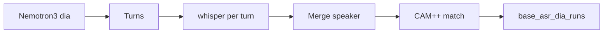

# ASR-DIA experiment (dia-first)

Optional Apple Silicon pipeline that **does not replace** cabin `whisper` / `diarize`.

## Why

Current edge diarize ([`workers/plugins/diarize`](../../workers/plugins/diarize)) labels **after** ASR: short Whisper cues → pad → WeSpeaker. On 2026-11-16 fixture staff (profiles ready) **median matched cues = 0%** — see [`asr_dia_fixture_2026-11-16.json`](asr_dia_fixture_2026-11-16.json). Gate: median &lt; 30% → try dia-first.

**ASR mode (default `words_align`):** one full-file `whisper-cli -ojf` (same large-v3 sense as cabin) → map segment text onto Nemotron turns; word timestamps only split cues that clearly cross speakers. Legacy `per_turn` (clip ASR) stays for A/B — avoid for quality.

## Pipeline

1. **Diarize first** — `speech diarize --engine nemotron3` ([speech-swift](https://github.com/soniqo/speech-swift)), or `dia.engine=vad_fallback` for smoke  
2. **ASR per turn** — whisper.cpp (`large-v3` or `podlodka-turbo` GGML)  
3. **ID** — WeSpeaker CAM++ (same as enrollment) → `SpeakerService::saveForRecord` when `apply_speakers=1`  
4. Journal — `base_asr_dia_runs` (optional apply transcription)

## Ops

| Step | Command / UI |
|------|----------------|
| Baseline | `php bin/asr-dia-baseline.php --day=2026-11-16` |
| Migrate | `php bin/freesaas.php migrate run --module=audio_diarize` |
| Edge | Enable plugin `asr_dia` only on experiment Mac; edge-host service **ASR-DIA**; copy `configs/example.json` → `local.json` |
| Queue | UI `/audio/asr-dia` or LongJob `POST /audio/asr-dia/longjob` (`day` / `ids_csv`, `asr_model`) |
| Compare ASR | `php bin/asr-dia-compare.php` (prod vs `TRANSCRIPTION_NEW`, dict hits) |
| Rebuild profiles | `php bin/asr-dia-rebuild-profiles.php` (manual embedded samples → centroid) |

Worker URLs: `GET /audio/asr/asr-dia-status`, `POST /audio/asr/asr-dia-result` (pull). Push: gateway `/v1/asr_dia/*` + cron `audio_diarize.push`.

## A/B ASR models

| id | File |
|----|------|
| `large-v3` | `$WHISPER_CPP_DIR/models/ggml-large-v3.bin` |
| `podlodka-turbo` | `ggml-podlodka-turbo-q8_0.bin` ([HF](https://huggingface.co/evilfreelancer/whisper-podlodka-turbo-GGUF)) |

Set `asr.model_id` in `workers/plugins/asr_dia/configs/local.json`. UI buttons enqueue with `asr_model` for journal only — **edge config must match** for the actual ggml path.

## Go / no-go

- Speaker ID: matched % ≫ baseline (target ≥50% or ×2+)  
- ASR: dict hits / listen sample not worse than prod; pick large-v3 vs podlodka  
- Stability: prod whisper/diarize claim unchanged  

**Studio smoke (2026-11-19, Mac Studio, record 291361, 180 s):** Nemotron3 + CAM++ → **matched_pct 100%** (26/26 cues) vs baseline **0%**; staff ids 145/127/85. Podlodka-turbo same dia, **faster** (~24 s vs ~36 s). Decision: **continue_experiment** — see [`asr_dia_decision_2026-11-16.json`](asr_dia_decision_2026-11-16.json), [`asr_dia_studio_ab_180s.json`](asr_dia_studio_ab_180s.json).

**Enabled on Mac Studio** alongside `whisper` / `diarize` / `egisz` (not replacing them). Edge-host service `asr_dia` on. Sample push (3×6 min, fixture ids): matched **60–83%**; **podlodka ~1.8× faster** than large-v3 (RTF mean 0.073 vs 0.132). Profiles rebuild **not** needed. Perf: [`asr_dia_perf_sample.json`](asr_dia_perf_sample.json). Runner: `php bin/asr-dia-sample-run.php --ids=… --model=podlodka-turbo`.

Mac Studio: `brew install speech`, whisper.cpp `~/Downloads/whisper.cpp`, models `ggml-large-v3.bin` + `ggml-podlodka-turbo-q8_0.bin`, plugin `/Users/lora/freesaas/workers/plugins/asr_dia`.

## Files

- Plugin: [`workers/plugins/asr_dia/`](../../workers/plugins/asr_dia/)  
- Fixture: [`asr_dia_fixture_2026-11-16.json`](asr_dia_fixture_2026-11-16.json)  
- FreeSaaS: `AsrDiaRunsRepository`, `AsrDiaPushDispatcher`, `AudioAsrDiaLongJob`, `/audio/asr-dia`
